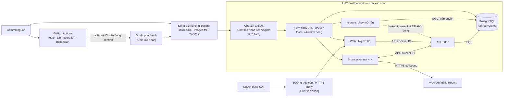

# 10. Deployment & Infrastructure Topology

**Trạng thái:** Bản nháp phục vụ xin triển khai UAT. Các mục **[Chờ xác nhận]** là thông tin về hạ tầng và quy trình thực tế; cấu hình trong repository không xác nhận những mục này.

## 10.1 Environments

| Environment | Purpose | Infrastructure | Internet Exposure | Data Type | HA/DR | Key Differences / Constraints |
| --- | --- | --- | --- | --- | --- | --- |
| Development | Phát triển và kiểm thử trên máy lập trình viên | Docker Compose chạy PostgreSQL, API, browser runner và Web trên một host | Web và API mặc định bind `127.0.0.1`; runner cần HTTPS outbound tới VAHAN | Dữ liệu phát triển/kiểm thử | Không được xác định trong repo | Mỗi máy tạo `.docker.env` riêng; không dùng chung volume dữ liệu theo mặc định |
| CI | Kiểm thử source, database integration, build và scan container images | GitHub Actions trên Linux, Windows và macOS; PostgreSQL tạm thời cho integration tests | Theo hạ tầng GitHub Actions | Dữ liệu kiểm thử | Không áp dụng | Workflow hiện có không deploy lên UAT |
| UAT | Nghiệm thu bản phát hành | **[Chờ xác nhận: host/VM, OS, CPU/RAM/disk, số host và số runner]**. Topology Compose hiện tại chạy trên một host | **[Chờ xác nhận: chỉ localhost, LAN, VPN hay Internet; domain và HTTPS]** | **[Chờ xác nhận: dữ liệu giả lập hay dữ liệu thật]** | **[Chờ xác nhận: backup, mục tiêu phục hồi, có/không có HA]** | Dùng cấu hình, secrets, Compose project và dữ liệu riêng; kiểm tra HTTPS outbound tới VAHAN |
| Production | Vận hành chính thức; không thuộc đợt xin triển khai UAT này | **[Chờ xác nhận: thiết kế và hạ tầng Production]** | [Chờ xác nhận] | [Chờ xác nhận] | [Chờ xác nhận] | Không dùng thông số AWS của tài liệu mẫu khi chưa được xác nhận cho dự án |

Compose định nghĩa một PostgreSQL với named volume `postgres_data`, một API, một Web và số lượng browser runner có thể điều chỉnh. Service `migrate` chạy trước API để chuẩn bị database và cấp quyền cho runtime role. Biến `VAHAN_ENVIRONMENT=production` trong Compose chỉ xác định chế độ cấu hình ứng dụng; nó không chứng minh rằng môi trường Production đã được triển khai.

## 10.2 Production Deployment Diagram (CI/CD)

Sơ đồ thể hiện luồng phát hành và topology ứng dụng có trong repository. **Đích của lần xin duyệt này là UAT.** Hạ tầng UAT, đường chuyển artifact và lớp truy cập phía trước Web cần được xác nhận; sơ đồ chưa đại diện cho một Production deployment đã vận hành.

CI hiện chạy kiểm thử trên source, database integration, build và security scan container images. Workflow **chưa có bước tự động deploy UAT**. Công cụ đóng gói riêng tạo source ZIP từ commit xác định, image TAR và manifest chứa hash cùng thông tin images; đây chưa phải là bước chạy trong workflow CI. Người phê duyệt, nơi lưu artifact, kênh chuyển và người triển khai UAT: **[Chờ xác nhận]**.

Trên host, Web và API mặc định chỉ publish lần lượt tại `127.0.0.1:5173` và `127.0.0.1:8000`. PostgreSQL và runner không publish port ra host trong Compose. Nếu người dùng truy cập từ máy khác, cần thiết kế đường truy cập phù hợp với hạ tầng UAT và xác nhận HTTPS.

## 10.3 Deployment Strategy

**Cài mới UAT — quy trình kỹ thuật đề xuất theo công cụ hiện có:**

1. Chọn commit phát hành; xác nhận kết quả CI của đúng commit đó. Tạo gói source/images/manifest, rồi kiểm SHA-256 và ID/digest của images trước khi cài.
2. Trên host UAT, nạp images, tạo `.docker.env` và đặt secrets/cổng/origin riêng cho UAT. Giữ file secrets ngoài artifact bàn giao.
3. Chạy bằng images đã nạp. Thứ tự phụ thuộc: PostgreSQL healthy → `migrate` thoát thành công → API healthy → Web và runners healthy.
4. Kiểm tra `/api/ready`, trạng thái containers, đăng nhập và smoke test theo [hướng dẫn cài đặt](docs/release/INSTALL.md). Tiêu chí nghiệm thu nghiệp vụ UAT: **[Chờ xác nhận]**.

**Nâng cấp UAT khi đã có dữ liệu:** chờ lượt chạy theo lịch và jobs hiện tại kết thúc (không để lịch Daily ở trạng thái PAUSED: lịch Daily còn session vẫn chặn migration `0015`); chạy deployment guard; tạo backup và thử restore vào Compose project tách biệt; sau đó nạp gói mới, chạy migration và kiểm tra lại hệ thống. Không dùng `docker compose down -v` trên project cần giữ dữ liệu. Nếu cần rollback sau migration, dùng image bản trước cùng backup tương ứng và phục hồi sang volume mới; chỉ đổi image cũ không bảo đảm tương thích database. Migration `0015` xóa lịch Daily đã lưu và không có downgrade dữ liệu; revision `0014a_daily_schedule_guard` dừng nâng cấp mà không xóa gì nếu lịch Daily còn session (xem [INSTALL §7](docs/release/INSTALL.md)).

**[Chờ xác nhận trước khi chốt kế hoạch UAT]:** người duyệt, người thao tác deploy, deployment window, downtime cho phép, nơi lưu backup và bản phát hành cũ, thời điểm quyết định rollback, tiêu chí nghiệm thu.

## 10.4 Infrastructure & Network Security

| Hạng mục bảo mật | Cấu hình / giải pháp thể hiện trong repository | Phạm vi UAT cần xác nhận |
| --- | --- | --- |
| Network segmentation | Các service kết nối qua mạng Compose; PostgreSQL và runner không publish port ra host. Repo không định nghĩa VPC/subnet/AZ hay firewall của UAT | Host, subnet, security group/firewall và các nguồn được phép kết nối |
| Ingress | Web và API mặc định bind `127.0.0.1`; Nginx phục vụ Web và proxy `/api/`, `/socket.io/` tới API | Người dùng vào qua localhost, LAN/VPN hay Internet; domain và tuyến qua reverse proxy |
| HTTPS/TLS | Stack không tự cấp TLS. Tài liệu release yêu cầu HTTPS reverse proxy phía trước khi mở truy cập từ máy khác | Certificate, nơi kết thúc TLS, người vận hành proxy; cấu hình CORS/Socket.IO origins theo URL thực tế |
| Outbound | Runner gọi VAHAN Public Report qua HTTPS | Firewall/proxy có cho phép đích này không; có TLS inspection không |
| Authentication và secrets | UI có đăng nhập; runner dùng token riêng với UI; `.docker.env` chứa mật khẩu, signing secret và khóa mã hóa browser state | Người tạo, lưu, truy cập và luân chuyển secrets; quyền truy cập host |
| Database access | `migrate` dùng database owner; API dùng runtime role với quyền hạn chế | Quyền truy cập DB của vận hành, chính sách backup/restore |
| Container và supply chain | Runner cấu hình seccomp/Chromium sandbox; PostgreSQL dùng image chính thức pin digest; CI build, scan và xuất SBOM | Chính sách chấp nhận kết quả scan, nơi lưu báo cáo và người duyệt rủi ro còn lại |
| Backup/DR | Có script backup và hướng dẫn restore vào Compose project tách biệt | Lịch backup, nơi lưu, retention, kiểm tra restore, RPO/RTO và người chịu trách nhiệm |
| Monitoring | Compose có health checks; API có `/api/ready`; runbook nêu các kiểm tra vận hành tối thiểu | Công cụ giám sát, người nhận cảnh báo, tần suất kiểm tra và thời gian phản hồi |

**Điều kiện cần xác nhận để hoàn thiện hồ sơ UAT:** topology mạng thực tế; HTTPS và đường truy cập; loại dữ liệu; luồng duyệt/chuyển/deploy artifact; backup và rollback; chính sách với kết quả security scan. Các thông số AWS trong tài liệu mẫu không phải bằng chứng về hạ tầng của dự án này.

### Nguồn đối chiếu

- [Compose và topology ứng dụng](compose.yaml)
- [Workflow CI](.github/workflows/platform.yml)
- [Công cụ đóng gói](scripts/build-review-package.py)
- [Hướng dẫn cài từ gói](docs/release/INSTALL.md)
- [Runbook vận hành và rollback](docs/release/ops/runbook.md)
- [Cấu hình và secrets](docs/release/config/config-reference.md)
- [Security review và rủi ro còn lại](docs/release/security/security-review.md)

**Mức kiểm chứng:** Nội dung về phần mềm được đối chiếu bằng cách đọc repository; hạ tầng UAT, thao tác deploy và chính sách của đơn vị vận hành chưa được xác nhận.
