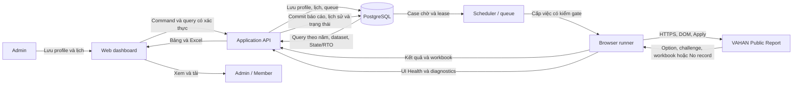
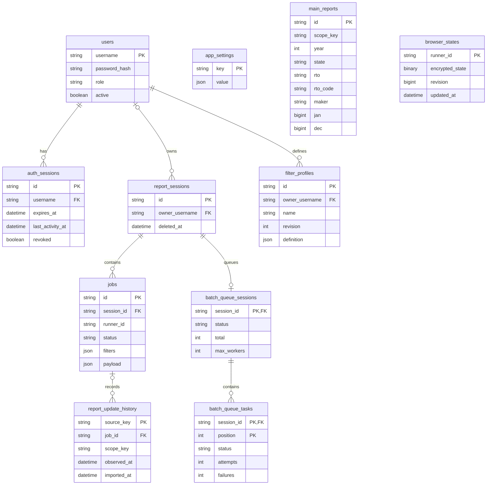
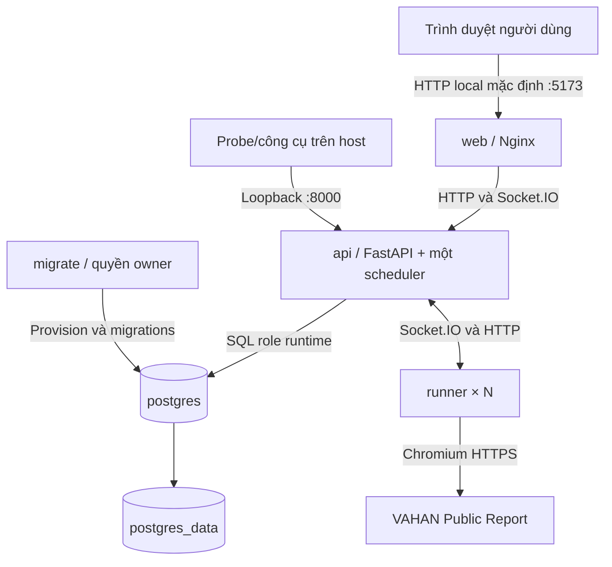

# PRODUCT REQUIREMENTS DOCUMENT — VAHAN AUTOMATION

**Tài liệu yêu cầu sản phẩm: Hệ thống tự động thu thập và khai thác báo cáo VAHAN**

| Thuộc tính | Nội dung |
| --- | --- |
| Mã tài liệu | VAHAN-PRD-001 |
| Phiên bản tài liệu | 1.0 — bản dự thảo để rà soát và nghiệm thu |
| Ngày lập | 15/10/2026, giờ Việt Nam |
| Sản phẩm | VAHAN Automation |
| Cơ sở rà soát | Repository `vahan-automation`, commit `2e4d25f145fe93b690380f406287dd5b3beb74f6` |
| Ngôn ngữ tài liệu | Tiếng Việt; giữ tên màn hình và thuật ngữ kỹ thuật cần đối chiếu |
| Người đọc | Chủ sản phẩm, quản trị viên, người dùng báo cáo, phát triển, kiểm thử và vận hành |
| Phê duyệt | Chưa ghi nhận phê duyệt PRD; phiên bản 1.0 của tài liệu không phải xác nhận sản phẩm đã phát hành |

Tài liệu mô tả sản phẩm theo mã nguồn và hồ sơ trong repository tại thời điểm lập. Các yêu cầu là cơ sở xác định hành vi cần cung cấp và cách nghiệm thu; việc một chức năng có mã nguồn không đồng nghĩa chức năng đó đã được nghiệm thu trên môi trường triển khai.

Trong lần lập PRD này chỉ rà soát tĩnh mã nguồn và tài liệu. Không chạy tác vụ thu thập VAHAN, không kiểm thử runtime, không triển khai container và không thay đổi dữ liệu nghiệp vụ. Bằng chứng chạy thực tế được dẫn từ hồ sơ cũ và phải giữ nguyên giới hạn về build, môi trường, thời điểm và loại workload.

## Mục lục

1. [Bối cảnh, mục tiêu và giá trị sản phẩm](#1-bối-cảnh-mục-tiêu-và-giá-trị-sản-phẩm)
2. [Người dùng, quyền và tổ chức sản phẩm](#2-người-dùng-quyền-và-tổ-chức-sản-phẩm)
3. [Phạm vi và hành trình nghiệp vụ](#3-phạm-vi-và-hành-trình-nghiệp-vụ)
4. [Yêu cầu phi chức năng và chỉ số thành công](#4-yêu-cầu-phi-chức-năng-và-chỉ-số-thành-công)
5. [Quyết định nền tảng và yêu cầu chức năng](#5-quyết-định-nền-tảng-và-yêu-cầu-chức-năng)
6. [Integration Architecture](#6-integration-architecture)
7. [Dữ liệu, Data Flow Diagram và Data Model / ERD](#7-dữ-liệu-data-flow-diagram-và-data-model--erd)
8. [Trải nghiệm người dùng và quy tắc giao diện](#8-trải-nghiệm-người-dùng-và-quy-tắc-giao-diện)
9. [Bảo mật và kiểm soát truy cập](#9-bảo-mật-và-kiểm-soát-truy-cập)
10. [Deployment & Infrastructure](#10-deployment--infrastructure)
11. [Capacity, Scalability & Reliability](#11-capacity-scalability--reliability)
12. [Observability & Operational Readiness](#12-observability--operational-readiness)
13. [Testing & Quality Strategy](#13-testing--quality-strategy)
14. [Risks & Open Issues / Tech Debt](#14-risks--open-issues--tech-debt)
15. [Appendix: Glossary, References và truy vết](#appendix-glossary-references-và-truy-vết)

## 1. Bối cảnh, mục tiêu và giá trị sản phẩm

### 1.1. Bài toán cần giải quyết

VAHAN Public Report cung cấp báo cáo tổng hợp đăng ký phương tiện theo nhiều điều kiện: năm, bang, cơ quan đăng ký xe, hãng, nhóm phương tiện và nhiên liệu. Việc thu thập bằng tay đòi hỏi người vận hành lặp lại thao tác chọn điều kiện, chờ cập nhật các lựa chọn phụ thuộc, thực hiện xác minh, áp dụng bộ lọc, tải báo cáo và tổng hợp kết quả.

Khi số tổ hợp tăng, các khó khăn chính là bỏ sót phạm vi cần thu thập, tải lặp, khó phân biệt nguồn không có dữ liệu với lỗi kỹ thuật, khó tiếp tục công việc bị gián đoạn và khó chia sẻ một bộ dữ liệu nhất quán cho người sử dụng.

VAHAN Automation tổ chức quy trình này thành bộ lọc lưu sẵn, lịch chạy phía máy chủ, hàng đợi công việc bền vững, browser runner thực thi và kho báo cáo dùng chung. Người xem báo cáo sử dụng dashboard để tìm kiếm và xuất Excel mà không cần trực tiếp thao tác trang VAHAN.

### 1.2. Tầm nhìn sản phẩm

Cung cấp một công cụ nội bộ giúp quản trị viên thu thập báo cáo VAHAN theo phạm vi có thể kiểm tra, theo dõi được kết quả từng lượt và phục hồi công việc gián đoạn; đồng thời giúp người dùng khai thác dữ liệu tổng hợp theo năm, State, RTO và Maker trên một giao diện thống nhất.

### 1.3. Mục tiêu nghiệp vụ

| Mã | Mục tiêu | Giá trị cho người dùng | Cách đánh giá |
| --- | --- | --- | --- |
| OBJ-01 | Giảm thao tác lặp khi thu thập | Lưu điều kiện một lần và sử dụng lại | So sánh số thao tác/thời gian thao tác tay trên cùng phạm vi |
| OBJ-02 | Kiểm soát độ đầy đủ của lượt chạy | Nhìn thấy tổng case, có dữ liệu, không dữ liệu và thất bại | Đối chiếu kế hoạch, queue và Run History |
| OBJ-03 | Giữ tính nhất quán của báo cáo | Retry không tạo bản ghi nghiệp vụ trùng | Kiểm identity case, ingest lặp và lịch sử cập nhật |
| OBJ-04 | Chia sẻ kết quả cho người xem | Xem và xuất dữ liệu mà không quản lý runner | Nghiệm thu hành trình member từ đăng nhập đến tải Excel |
| OBJ-05 | Giảm công việc mất do gián đoạn | Tiếp tục cùng lượt sau pause, restart hoặc mất kết nối phù hợp | Thử phục hồi và đối chiếu case/session trước và sau |
| OBJ-06 | Hỗ trợ chẩn đoán có căn cứ | Biết lỗi ở kết nối, DOM, OCR, download hay lưu dữ liệu | Kiểm diagnostics và khả năng liên hệ lỗi với run/job/runner |

Chưa có phép đo trước/sau đủ để công bố tỷ lệ tiết kiệm thời gian hoặc ROI. Các mục tiêu trên là mục tiêu sản phẩm; không diễn giải thành số liệu hiệu quả đã đạt.

### 1.4. Đầu ra nghiệp vụ

- Bộ lọc thu thập có tên, năm báo cáo và quy tắc tạo tổ hợp.
- Kế hoạch case dự kiến trước khi chạy.
- Lịch chạy một lần hoặc hằng tháng theo múi giờ hỗ trợ.
- Trạng thái thực thi, kết quả và lỗi của mỗi lượt/case.
- Báo cáo tổng hợp theo năm với các cột State, RTO, RTOCode, Maker và JAN–DEC.
- File Excel của toàn bộ phạm vi được chọn hoặc kết quả tìm kiếm State/RTO.
- Diagnostics, lịch sử cập nhật và tài liệu vận hành phục vụ hỗ trợ.

Nguồn đối chiếu: REF-01, REF-02, REF-03, REF-04.

## 2. Người dùng, quyền và tổ chức sản phẩm

### 2.1. Tổ chức các khối logic

Phần này mô tả trách nhiệm logic. Container và mạng triển khai được trình bày riêng ở mục 10.

| Khối | Trách nhiệm | Kết quả cung cấp |
| --- | --- | --- |
| Dashboard | Đăng nhập, cấu hình, theo dõi và khai thác báo cáo | Trải nghiệm web cho admin và member |
| Application API | Xác thực, phân quyền, kiểm tra dữ liệu đầu vào và cung cấp nghiệp vụ | API có kiểm soát quyền và dữ liệu nhất quán |
| Planning & Scheduling | Mở rộng profile thành case, quản lý lịch, điều phối pause/resume | Kế hoạch và lượt chạy có identity bền vững |
| Browser Execution | Mở VAHAN, kiểm DOM, điền filter, OCR, Apply và tải workbook | Kết quả DATA, NO_DATA hoặc lỗi có ngữ cảnh |
| Data & Reporting | Lưu tài khoản, queue, browser state, báo cáo và lịch sử; xuất Excel | Kho báo cáo dùng chung và khả năng truy vết |
| Diagnostics & Operations | Health, network status, UI Health, log, backup và công cụ release | Tín hiệu vận hành và quy trình phục hồi |

### 2.2. Nhóm người dùng

| Persona | Nhu cầu chính | Tần suất điển hình | Quyền sản phẩm |
| --- | --- | --- | --- |
| Quản trị viên nghiệp vụ | Tạo filter, lập lịch, kiểm kết quả và xử lý lượt lỗi | Khi tạo phạm vi mới và theo dõi các lượt định kỳ | `admin` |
| Người xem báo cáo | Tra cứu số liệu và tải Excel | Theo nhu cầu phân tích | `user`, hiển thị là Workspace member/report viewer |
| Người vận hành kỹ thuật | Cài đặt, cập nhật, theo dõi container, backup/restore và chẩn đoán | Định kỳ và khi có sự cố | Quyền hạ tầng bên ngoài ứng dụng; không phải role thứ ba |
| Người kiểm thử | Kiểm hành vi và thu bằng chứng trên môi trường tách biệt | Trước phát hành hoặc thay đổi | Tài khoản thử được cấp theo vai trò cần kiểm |

Browser runner là tác nhân kỹ thuật dùng credential riêng của hệ thống, không phải tài khoản người dùng trên dashboard.

### 2.3. Ma trận quyền nghiệp vụ

| Hoạt động | Chưa đăng nhập | Member `user` | Admin `admin` | Browser runner |
| --- | --- | --- | --- | --- |
| Đăng nhập | Có | Có | Có | Không dùng luồng UI |
| Xem/tìm/xuất báo cáo chung | Không | Có | Có | Không được cấp quyền qua runner credential |
| Đổi mật khẩu cá nhân, đăng xuất | Không | Có | Có | Không |
| Chọn múi giờ hiển thị cá nhân | Không | Có trên giao diện | Có trên giao diện | Không |
| Quản lý filter và lịch | Không | Không | Có | Chỉ nhận công việc/lấy option theo giao thức |
| Xem Run History và diagnostics quản trị | Không | Không | Có | Chỉ gửi bằng chứng thuộc giao thức runner |
| Tạo/khóa tài khoản, đổi role, reset mật khẩu | Không | Không | Có | Không |
| Claim queue, báo kết quả, đọc/ghi runner state | Không | Không | Không dùng runner credential của người dùng | Có trong allowlist kỹ thuật |
| Backup, restore, thay image/container | Không | Không qua UI | Không qua quyền UI đơn thuần | Không |

Mật khẩu người dùng không được dùng thay runner token. Quyền admin trong dashboard cũng không tự cấp quyền quản trị máy chủ. Trạng thái theme/múi giờ cá nhân trên trình duyệt không có nghĩa member được phép ghi mọi `user-state` qua API.

### 2.4. Các bên tham gia và trách nhiệm

Chủ sản phẩm quyết định phạm vi, ưu tiên, chính sách dữ liệu và việc chấp nhận rủi ro. Phát triển triển khai và giải thích giới hạn. QA kiểm tiêu chí nghiệm thu và bảo quản bằng chứng. Vận hành quản lý môi trường, secrets và phục hồi. Một người có thể đảm nhiệm nhiều trách nhiệm; PRD không giả định đội ngũ hoặc cơ cấu tổ chức chưa được xác nhận.

Nguồn đối chiếu: REF-02, REF-07, REF-08.

## 3. Phạm vi và hành trình nghiệp vụ

### 3.1. Phạm vi chức năng cốt lõi

| Nhóm | Trong phạm vi |
| --- | --- |
| Tài khoản | Đăng nhập bằng username/password, phiên có thời hạn, đổi/reset mật khẩu, khóa/mở và phân vai admin/user |
| Filter Profiles | Lưu và sửa profile, chọn năm, tải option từ VAHAN, xử lý phụ thuộc, fixed/iterate, include/exclude và combination rules |
| Preview | Sinh kế hoạch dựa trên profile và option nguồn; cho biết khối lượng trước khi chạy |
| Lịch | Once/Monthly, múi giờ Việt Nam/Ấn Độ, bật/tắt lần chạy tương lai, xử lý cuối tháng/chuyển năm |
| Thực thi | SQL queue, runner pool, preflight, browser automation, OCR Tesseract và download workbook |
| Điều khiển | Pause/drain, resume cùng session, retry và phục hồi theo lease/identity |
| Khai thác | Bảng năm, chọn dataset, State/RTO search, phân trang và Excel export |
| Theo dõi | Run History cho admin, tiến độ, kết quả, ETA có điều kiện và diagnostics |
| Vận hành | Docker Compose, migration, readiness, backup/restore và guard trước thay thế dịch vụ |

### 3.2. Phạm vi báo cáo

Baseline được rà soát là **Calendar Year / Maker / Month Wise**. Một profile chọn một năm; hai ô From/To trên form không biểu diễn khoảng nhiều năm. Năm báo cáo độc lập với ngày chạy lịch. Cùng một năm có thể có nhiều dataset theo phạm vi filter.

Đầu ra chính là số lượng đăng ký tổng hợp. PRD này không yêu cầu thu thập hồ sơ cá nhân của chủ xe, biển số hoặc định danh phương tiện riêng lẻ.

### 3.3. Ngoài phạm vi baseline

- Maker Update và các entry point cũ đã được gỡ khỏi sản phẩm hiện hành.
- Lịch Daily; hợp đồng lịch mới chỉ nhận `once` và `monthly`.
- SSO/IdP, đăng nhập MFA, cổng tự đăng ký hoặc quy trình quên mật khẩu qua email.
- LLM, chatbot, AI agent suy luận hoặc dịch vụ OCR đám mây trong luồng hiện tại.
- Ứng dụng di động riêng và tích hợp doanh nghiệp không có trong repository.
- API báo cáo chính thức từ VAHAN thay cho thao tác browser.
- Multi-tenant có cách ly dữ liệu từng tổ chức; baseline là kho báo cáo dùng chung theo quyền ứng dụng.
- Autoscaling tự động, nhiều API scheduler đồng thời, HA đa host, Kubernetes và database replication được vận hành hoàn chỉnh.
- Cam kết gửi email/SMS cảnh báo tự động.
- Quy trình import dữ liệu legacy được hỗ trợ chính thức; script nội bộ còn tồn tại không tạo thành chức năng bàn giao.
- Cam kết cài đặt end-to-end trên mọi hệ điều hành/kiến trúc.
- Dự toán hạ tầng, chi phí vận hành và ROI khi chưa có đầu bài, workload và đơn giá được xác nhận.

Các cải tiến ở mục 14 là backlog/điểm cần quyết định, không tự động trở thành cam kết của baseline.

### 3.4. Hành trình quản trị viên: thiết lập và thu thập

1. Đăng nhập bằng tài khoản admin.
2. Vào Filters, tạo profile, chọn năm và rà soát điều kiện mặc định.
3. Tải option VAHAN, chọn các filter theo thứ tự phụ thuộc và lưu profile.
4. Chạy Save & preview, đối chiếu số case và phạm vi dự kiến.
5. Tạo lịch Once/Monthly với thời gian tương lai và múi giờ rõ ràng.
6. Khi đến hạn, hệ thống xác minh điều kiện chạy, mạng và UI Health, rồi chuẩn bị queue.
7. Runner nhận case theo năng lực khả dụng, thực hiện VAHAN và ghi kết quả.
8. Admin theo dõi tiến độ, NO_DATA và lỗi; pause/resume khi cần.
9. Kiểm báo cáo được lưu, độ đầy đủ theo phạm vi và Run History.

**Kết thúc thành công:** dữ liệu đã commit, các case đạt trạng thái cuối phù hợp, phần thất bại còn lại được thể hiện. Một lượt có `NO_DATA` hợp lệ vẫn có thể hoàn thành; có một phần dữ liệu không đủ để kết luận cả lượt thành công.

### 3.5. Hành trình member: khai thác dữ liệu

1. Đăng nhập và mở Exported Reports.
2. Chọn Year và Report filters nếu có nhiều dataset.
3. Tìm theo State và/hoặc RTO/code.
4. Đọc số liệu, thời điểm cập nhật và các tháng có dữ liệu.
5. Chọn Export filtered to Excel hoặc Export all to Excel.
6. Kiểm phạm vi/số dòng trong hộp xác nhận, xác nhận và tải file.

**Kết thúc thành công:** file chứa toàn bộ dòng khớp năm/dataset/điều kiện tìm kiếm, không bị giới hạn ở trang đang xem.

### 3.6. Hành trình gián đoạn và phục hồi

| Tình huống | Hành vi yêu cầu | Điều kiện kết thúc |
| --- | --- | --- |
| Không có runner sẵn sàng | Giữ công việc chờ; thông báo nguyên nhân | Có runner và các gate đạt thì được giao tiếp |
| Admin pause | Ngừng giao mới; để case đã nhận drain | Đạt trạng thái paused, phần chưa chạy còn nguyên |
| Resume | Kiểm lại gate phù hợp và tiếp tục session cũ | Case còn lại được xử lý, tổng case không tăng do resume |
| Mất mạng VAHAN | Phân biệt với NO_DATA; giữ khả năng phục hồi | Có mạng và gate hợp lệ thì tiếp tục theo policy |
| Runner disconnect | Dùng grace/lease và kiểm attempt trước giao lại | Không mất case hoặc nhận kết quả cũ ghi đè kết quả mới |
| API restart | Nạp lại trạng thái từ PostgreSQL | Không dựa riêng vào tab trình duyệt để tái tạo công việc |
| Lỗi DOM/preflight | Giữ diagnostics, chặn thao tác không an toàn | Có kiểm chứng hợp lệ hoặc thao tác phục hồi được kiểm soát |

### 3.7. Quy tắc nghiệp vụ xuyên suốt

| Mã | Quy tắc |
| --- | --- |
| BR-01 | Profile xác định năm/phạm vi dữ liệu; thời gian lịch xác định lúc thực thi. |
| BR-02 | Option phụ thuộc phải được xác minh theo lựa chọn cha; không ghép tùy ý option từ nhánh khác. |
| BR-03 | Preview chỉ lập kế hoạch, không thực thi thu thập và không sinh dữ liệu báo cáo giả. |
| BR-04 | Một case là một đơn vị nghiệp vụ; nhiều job attempt không làm tăng số case. |
| BR-05 | NO_DATA hợp lệ là kết quả cuối, không phải lỗi cần retry vô hạn. |
| BR-06 | Thành công phải gắn với việc lưu kết quả được API/DB xác nhận. |
| BR-07 | Pause khác Disable future runs: pause điều khiển lượt hiện tại; disable điều khiển lịch tương lai. |
| BR-08 | Retry/resume giữ session, case và phạm vi gốc; phải truy vết được các lần thử. |
| BR-09 | `0` và dữ liệu tháng còn thiếu có ý nghĩa khác nhau. |
| BR-10 | Export dùng điều kiện tìm kiếm và dataset/year; không dùng page offset/limit của bảng. |
| BR-11 | Xóa profile/lịch không mặc nhiên xóa báo cáo đã commit. |
| BR-12 | Không dùng dữ liệu mẫu để biểu diễn kết quả thu thập thật hoặc che trạng thái chưa có dữ liệu. |
| BR-13 | Số runner khả dụng khác giới hạn song song logic; cấu hình logic không tự tạo container. |
| BR-14 | Health xanh không thay thế nghiệm thu VAHAN, OCR, download và chất lượng dữ liệu. |

Nguồn đối chiếu: REF-02, REF-03, REF-04, REF-05, REF-06, REF-09.

## 4. Yêu cầu phi chức năng và chỉ số thành công

### 4.1. Cách đọc mức ưu tiên và bằng chứng

**P0:** đề xuất coi là bắt buộc cho luồng sản phẩm cốt lõi. **P1:** quan trọng cho vận hành hoặc trải nghiệm. **P2:** cải tiến sau baseline. Đây là mức ưu tiên trong bản dự thảo PRD, không thay thế quyết định release hoặc severity đã được duyệt trong hồ sơ bàn giao.

Các nhãn sau được dùng trong mục 5 và mục 14:

- **C — Có mã:** đã tìm thấy logic tương ứng trong repository; chưa phải chứng nhận runtime.
- **H — Hồ sơ:** có mô tả hoặc kết quả kiểm chứng lịch sử trong repository; chỉ có hiệu lực trong phạm vi hồ sơ đó.
- **ĐX — Đề xuất:** tiêu chí bổ sung hoặc cải tiến chưa được cam kết là đã triển khai.
- **M — Cần quyết định:** thông số/chính sách chưa có cơ sở để chốt.

Một dòng `C/H` nghĩa là có triển khai và hồ sơ liên quan, không có nghĩa mọi tiêu chí của dòng đã pass trên commit hiện tại.

### 4.2. Danh mục NFR

| Mã | Nhóm | Yêu cầu | Cách nghiệm thu |
| --- | --- | --- | --- |
| NFR-01 | Toàn vẹn | Không mất hoặc nhân đôi case nghiệp vụ do retry/reconnect | Đối chiếu tập case identity và kết quả trước/sau can thiệp |
| NFR-02 | Lưu bền | Profile, lịch, queue và kết quả cần tồn tại qua restart phù hợp | Restart trên môi trường thử, đối chiếu dữ liệu/identity |
| NFR-03 | Quyền truy cập | Member không đọc/ghi chức năng admin bằng API trực tiếp | Ma trận endpoint và kiểm UI/API với hai role |
| NFR-04 | Thông tin nhạy cảm | Không log password/token/encryption key hoặc nội dung OCR thô | Rà log, diagnostics, backup và source liên quan |
| NFR-05 | Tính đúng báo cáo | Giữ dataset/year/grain; phân biệt `0` và thiếu; ingest lặp an toàn | Đối chiếu workbook nguồn, DB, UI và export |
| NFR-06 | Khả dụng có điều kiện | Hiển thị trạng thái chờ/lỗi rõ khi VAHAN/runner không sẵn sàng | Thử mất mạng, không runner, DOM mismatch và reconnect |
| NFR-07 | Khả năng chẩn đoán | Lỗi có mã/ngữ cảnh đủ truy tới thao tác, runner và job khi có | Thu lỗi mẫu và kiểm chuỗi API → UI → diagnostics |
| NFR-08 | Khả năng sử dụng | Không buộc giữ tab mở để scheduler tiếp tục chạy | Đóng tab giữa lượt trong môi trường thử, mở lại và đối chiếu |
| NFR-09 | Khả năng phục hồi | Có backup/restore và quy trình nâng cấp không thay volume/key tùy tiện | Restore vào project riêng, đối chiếu dữ liệu và readiness |
| NFR-10 | Khả năng kiểm thử | Tách fixture/synthetic, HTTP/DB, image/runtime và VAHAN live | Báo cáo kết quả ghi rõ lớp bằng chứng và SHA |
| NFR-11 | Khả năng triển khai | Secrets riêng, migration đúng revision và runtime DB role hạn chế | Cài mới/nâng cấp theo checklist release |
| NFR-12 | Hiệu năng | Bảng, tìm kiếm và export có ngân sách hiệu năng được đo | Đo theo dataset/workload; ngưỡng p95 chính thức còn M |
| NFR-13 | Khả năng tiếp cận | Đề xuất hỗ trợ bàn phím, focus và thông báo trạng thái dễ đọc | Kiểm các hành trình ở mục 8; chưa tuyên bố đạt chứng nhận accessibility |

Không tự đặt SLA 99,9%, số người dùng đồng thời, RPO/RTO, dung lượng tối đa hoặc độ chính xác OCR nếu chưa có phép đo/đồng thuận. Phương pháp đo năng lực được mô tả ở mục 11, không lặp thành một bộ cam kết khác.

### 4.3. Chỉ số thành công và định nghĩa phép đo

| Mã | Chỉ số | Định nghĩa | Mục tiêu/giới hạn |
| --- | --- | --- | --- |
| KPI-01 | Tỷ lệ case có kết quả hợp lệ | `(case có dữ liệu đã lưu + NO_DATA hợp lệ) / tổng case trong phạm vi` | Đo theo từng run; chưa chốt tỷ lệ tối thiểu chung |
| KPI-02 | Case thất bại cuối | Số case FAILED sau policy retry | Phải hiển thị đúng và có nguyên nhân; không giấu trong Completed |
| KPI-03 | Độ trùng do retry/ingest | Case nghiệp vụ hoặc dòng báo cáo tăng sai khi gửi lại cùng kết quả | Kỳ vọng 0 trong bộ tình huống nghiệm thu đã xác định |
| KPI-04 | Độ khớp Excel | Dòng và giá trị export so với tập DB cùng điều kiện | Khớp hoàn toàn tại snapshot kiểm thử kiểm soát |
| KPI-05 | Throughput | Case terminal/phút và dòng báo cáo/phút | Báo riêng DATA/NO_DATA/retry và số runner; chưa có cam kết chung |
| KPI-06 | Độ mới dữ liệu | Khoảng cách giữa thời điểm quan sát/lưu nguồn và thời điểm khai thác | Phụ thuộc lịch và khả dụng VAHAN; không đồng nhất với tuổi dữ liệu của nguồn |
| KPI-07 | Độ chính xác ETA | Trung vị sai số tuyệt đối tương đối theo cửa sổ tiến độ | Tiêu chí lịch sử D-28: ≤25% ở 50–75%; ≤15% ở 75–100%; áp dụng đúng điều kiện mục 13.4 |
| KPI-08 | Thời gian phục hồi | Từ khi điều kiện mạng/runner phục hồi đến khi giao tiếp công việc | Đo riêng từng tình huống; chưa có SLO chính thức |
| KPI-09 | Thời gian thao tác tay | Thời gian người dùng chủ động thao tác trên cùng phạm vi | Chưa có baseline để công bố phần trăm tiết kiệm |

Người dùng cuối không bị yêu cầu hiểu công thức đo. Dashboard cần trình bày kết quả bằng ngôn ngữ nghiệp vụ; công thức và bằng chứng dành cho người đánh giá.

## 5. Quyết định nền tảng và yêu cầu chức năng

### 5.1. Key Architecture Decisions

Đây là các quyết định thực tế đọc được từ source, không phải một ADR Log giả định đã có quy trình phê duyệt.

| Mã | Quyết định baseline | Hệ quả sản phẩm |
| --- | --- | --- |
| KAD-01 | Web dashboard React/Vite; API FastAPI/Socket.IO | Người dùng thao tác bằng trình duyệt; trạng thái cập nhật qua API/realtime |
| KAD-02 | PostgreSQL là nguồn trạng thái bền vững và hàng đợi điều phối | UI hoặc socket không phải nguồn duy nhất quyết định case đã hoàn tất |
| KAD-03 | Dùng Playwright/Chromium với trang VAHAN Public Report | Phụ thuộc DOM, network, TLS, CAPTCHA và hành vi export của nguồn |
| KAD-04 | OCR Tesseract chạy trong runner | Không có LLM hoặc dịch vụ OCR cloud trong baseline |
| KAD-05 | Lưu browser state mã hóa bằng Fernet | Backup/restore phải giữ khóa phù hợp; ciphertext không thay thế bảo vệ secrets |
| KAD-06 | Hai role người dùng `admin`/`user`; credential runner tách khỏi tài khoản UI | Quyền quản trị, khai thác báo cáo và thực thi kỹ thuật có ranh giới riêng |
| KAD-07 | Compose một host, một API scheduler và runner replicas | Tăng runner không đồng nghĩa có HA hoặc nhiều scheduler an toàn |
| KAD-08 | Báo cáo chính lấy từ workbook xuất đầy đủ của nguồn, API xác nhận commit | Không dùng bảng DOM có thể thiếu dòng làm thay thế cho workbook DATA |
| KAD-09 | Preflight/UI Health chặn thao tác khi chưa xác minh được giao diện nguồn | Ưu tiên tránh lấy sai dữ liệu; còn giới hạn gate toàn đội ở mục 14 |

### 5.2. Tài khoản và phiên đăng nhập

| Mã | Yêu cầu và tiêu chí nghiệm thu | Ưu tiên | Cơ sở |
| --- | --- | --- | --- |
| FR-AUTH-01 | Đăng nhập bằng username/password hợp lệ; tài khoản bị khóa hoặc thông tin sai không nhận phiên sử dụng hợp lệ. | P0 | C/H, REF-07/08 |
| FR-AUTH-02 | Áp quyền ở server cho mọi API nghiệp vụ; member truy cập trực tiếp chức năng admin nhận từ chối phù hợp, kể cả khi sửa URL/request. | P0 | C/H, REF-07/08 |
| FR-AUTH-03 | Phiên có giới hạn tuyệt đối 12 giờ và idle 1 giờ theo cấu hình code hiện tại; khi hết hạn, thao tác được bảo vệ yêu cầu đăng nhập lại. Polling không được coi mặc nhiên là hoạt động người dùng. | P0 | C/H, REF-08 |
| FR-AUTH-04 | Đăng xuất thu hồi phiên hiện tại; token phiên bị thu hồi không được tiếp tục gọi API được bảo vệ. | P0 | C/H, REF-08 |
| FR-AUTH-05 | Người dùng đổi mật khẩu bằng mật khẩu hiện tại và mật khẩu mới khác, dài tối thiểu 12 ký tự; phiên khác bị thu hồi, phiên hiện tại được giữ theo handler. | P0 | C/H, REF-08 |
| FR-AUTH-06 | Admin tạo tài khoản, reset mật khẩu, khóa/mở và đổi role; username trùng bị từ chối và mật khẩu reset tuân giới hạn đầu vào. | P0 | C/H, REF-08 |
| FR-AUTH-07 | Không cho khóa/hạ role làm mất admin đang hoạt động cuối cùng. Đổi role hoặc khóa tài khoản làm các phiên của tài khoản đó mất hiệu lực. | P0 | C, REF-08 |
| FR-AUTH-08 | Cho chọn múi giờ hiển thị Việt Nam/Ấn Độ. Với admin, luồng thay đổi có cập nhật múi giờ lịch đã lưu theo triển khai; phải kiểm lại thời điểm chạy và hiển thị, không coi chỉ là đổi nhãn. | P1 | C/H, REF-02/04 |

**Ví dụ nghiệm thu:** member đăng nhập, xem báo cáo thành công, sau đó gọi API tạo lịch và nhận 403. Việc menu bị ẩn riêng lẻ chưa đủ chứng minh phân quyền đúng.

### 5.3. Filter Profiles và lập kế hoạch

| Mã | Yêu cầu và tiêu chí nghiệm thu | Ưu tiên | Cơ sở |
| --- | --- | --- | --- |
| FR-FLT-01 | Admin tạo/sửa/xóa profile có tên và definition version; tên không trắng, tối đa 120 ký tự; update có kiểm revision theo hợp đồng lưu. | P0 | C, REF-09 |
| FR-FLT-02 | Profile gắn một năm Calendar Year, trục Y Maker và trục X Month Wise; từ chối định nghĩa ngoài schema, năm sai kiểu hoặc vượt giới hạn model. | P0 | C, REF-09 |
| FR-FLT-03 | Hỗ trợ State region, State, RTO, Category group, Sub-category, Class, EV type, Fuel, Active/Archive, Emission, Maker, Status, Owner type, Vehicle type và Fitness theo field hợp lệ. | P0 | C, REF-09 |
| FR-FLT-04 | Option preview/điền filter lấy từ nguồn VAHAN qua runner; không có option thật hoặc runner hợp lệ thì chờ/báo lỗi, không tự thay bằng danh sách mẫu. | P0 | C/H, REF-05/09 |
| FR-FLT-05 | Giữ thứ tự phụ thuộc: State region → State → RTO; Category group → Sub-category → Class; EV type → Fuel. Đổi cha phải rà lại lựa chọn con. | P0 | C/H, REF-09 |
| FR-FLT-06 | `fixed` dùng các giá trị chọn cùng một điều kiện; `iterate` tách từng giá trị thành nhánh. Iterate không chỉ định tập con dùng toàn bộ option hợp lệ của ngữ cảnh. | P0 | C/H, REF-02/09 |
| FR-FLT-07 | Áp include/exclude và combination rules require/exclude trước khi xác định tập case; trường không hỗ trợ và rule tự tham chiếu bị từ chối. | P1 | C, REF-09 |
| FR-FLT-08 | Save & preview cho biết kế hoạch/số case mà không bắt đầu thu thập; các nhánh cần thu thập không bị bỏ âm thầm. | P0 | C/H, REF-09/17 |
| FR-FLT-09 | Mỗi case có bộ filter xác định và khóa chuẩn hóa để hỗ trợ đối chiếu/lặp; không tạo hai case chỉ vì khác thứ tự cùng tập lựa chọn. | P0 | C, REF-09 |
| FR-FLT-10 | Xóa profile yêu cầu xác nhận và đúng revision; báo cáo đã lưu vẫn được giữ. Lịch giữ snapshot definition/profileRevision trong dữ liệu riêng; không giả định xóa profile sẽ cascade xóa lịch hoặc kết quả. | P1 | C/H, REF-02/09 |

**Lưu ý đầu vào:** model hiện giới hạn mỗi danh sách values/include ở 100, exclude ở 500 và combination rules ở 30. Đây là validation của definition, không phải cam kết giới hạn tổng số case. Không suy từ sự tồn tại của khóa `maxCases` legacy rằng hệ thống còn áp trần đó.

**Ví dụ nghiệm thu:** chọn 2 State ở iterate, mỗi State có tập RTO riêng. Preview phải dùng RTO đúng State, tính đúng tổng nhánh và không tạo tích chéo State/RTO không hợp lệ.

### 5.4. Lịch thu thập tự động

| Mã | Yêu cầu và tiêu chí nghiệm thu | Ưu tiên | Cơ sở |
| --- | --- | --- | --- |
| FR-SCH-01 | Admin tạo lịch từ profile đã lưu với thời điểm tương lai có timezone/offset; từ chối thời gian quá khứ hoặc thiếu timezone. | P0 | C/H, REF-04/09 |
| FR-SCH-02 | Hỗ trợ `once`/`monthly`; `daily` hoặc kiểu repeat khác bị từ chối. Múi giờ hỗ trợ là `Asia/Ho_Chi_Minh` và `Asia/Kolkata`. | P0 | C/H, REF-04/09 |
| FR-SCH-03 | Form lấy năm báo cáo từ profile, không yêu cầu worker count theo lịch. Các khóa `workerCount` legacy không được dùng để thay pool hoặc phục hồi concurrency cũ. | P0 | C/H, REF-04/09 |
| FR-SCH-04 | Lịch đến hạn được scheduler phía server xử lý dù tab đã đóng; nếu thiếu runner/mạng/preflight thì giữ trạng thái chờ đúng nguyên nhân. | P0 | C/H, REF-04/10 |
| FR-SCH-05 | Lịch Once hoàn tất không tự lập lại lần kế tiếp; thể hiện không còn future run. | P0 | C/H, REF-04/17 |
| FR-SCH-06 | Monthly giữ giờ địa phương theo zone; ngày không tồn tại trong tháng được clamp về cuối tháng. Kiểm riêng ngày 29/30/31 và qua năm. | P0 | C/H, REF-04/09 |
| FR-SCH-07 | Luồng chuyển năm tạo profile/lịch năm tiếp theo theo logic thực tế, giữ liên hệ và tránh bản sao trùng; chưa có full live evidence cho mọi biên lịch thì ghi rõ khi nghiệm thu. | P1 | C/H, REF-04/09 |
| FR-SCH-08 | Disable future runs ngừng các lần tương lai, không đồng nghĩa pause lượt hiện tại; bật lại cần có next start nhất quán. | P0 | C/H, REF-02/17 |
| FR-SCH-09 | Xóa lịch chỉ khi trạng thái và ràng buộc cho phép; giữ báo cáo đã commit, thông báo rõ tác động lên phần công việc chưa hoàn thành. | P1 | C/H, REF-02/09 |

Không đặt độ trễ chạy lịch bằng 0 giây: scheduler còn phụ thuộc preflight và năng lực runner. Ngân sách trễ chấp nhận được phải đo trên môi trường mục tiêu.

### 5.5. Queue, thực thi browser và OCR

| Mã | Yêu cầu và tiêu chí nghiệm thu | Ưu tiên | Cơ sở |
| --- | --- | --- | --- |
| FR-RUN-01 | Lưu run/session/task/case trong SQL; runner claim bằng transaction, kiểm trạng thái/lease/giới hạn để tránh cùng case bị giao đồng thời không hợp lệ. | P0 | C/H, REF-06/10 |
| FR-RUN-02 | Mỗi runner xử lý tối đa một case thực thi cùng lúc; số đang chạy không vượt runner đủ điều kiện và giới hạn logic có hiệu lực. | P0 | C/H, REF-10 |
| FR-RUN-03 | Preflight kiểm control/DOM theo UI contract trước thao tác cần gate; không Apply để vượt khi gate chưa đạt. Lưu bằng chứng và version contract. | P0 | C/H, REF-05/11 |
| FR-RUN-04 | Điền filter theo phụ thuộc, đọc lại DOM để xác minh lựa chọn; sai hoặc thiếu điều kiện phải báo lỗi, không ghi kết quả như đúng phạm vi. | P0 | C/H, REF-09/10 |
| FR-RUN-05 | OCR dùng Tesseract trong runner với challenge hiện tại. API bắt đầu OCR kiểm credential runner, job đang thuộc runner, trạng thái và captchaId; challenge cũ bị từ chối. | P0 | C/H, REF-12 |
| FR-RUN-06 | Ứng dụng không áp quota số lần bắt đầu OCR; điều này không loại bỏ validation, timeout, retry policy hay giới hạn của VAHAN. Không log chuỗi OCR thô. | P0 | C/H, REF-12 |
| FR-RUN-07 | DATA yêu cầu workbook export đầy đủ từ nguồn, upload vào main-report và chờ API xác nhận lưu trước khi nhận case kế tiếp; export thiếu/commit lỗi không được báo thành công. | P0 | C/H, REF-03/10 |
| FR-RUN-08 | NO_DATA chỉ được ghi khi có bằng chứng nguồn hợp lệ; timeout, TLS, 404 hoặc lỗi download không được chuyển thành NO_DATA. | P0 | C/H, REF-06/10 |
| FR-RUN-09 | Kết quả gửi lại hoặc đến muộn phải qua kiểm identity/trạng thái phù hợp; không ghi đè attempt mới hoặc đếm hoàn tất hai lần. | P0 | C/H, REF-06/10 |
| FR-RUN-10 | Ghi nhận lỗi có stage/code/detail phù hợp để phân biệt mở trang, network, DOM, OCR, Apply, download và lưu báo cáo. | P1 | C/H, REF-05/10 |

Luồng nghiệp vụ rút gọn: **claim → mở/khôi phục VAHAN → kiểm giao diện → điền và xác minh filter → xử lý CAPTCHA khi có → Apply → đợi kết quả → tải/commit DATA hoặc ghi NO_DATA → trả case về trạng thái cuối**. Đây là luồng nghiệp vụ, không yêu cầu thứ tự CAPTCHA cố định cho mọi trạng thái trang nguồn.

`WAITING_CAPTCHA` là trạng thái thực thi báo cáo, không phải bằng chứng ứng dụng dùng CAPTCHA đăng nhập hoặc MFA. Baseline không cam kết tỷ lệ OCR thành công 100%.

### 5.6. Pause, resume, retry và phục hồi

| Mã | Yêu cầu và tiêu chí nghiệm thu | Ưu tiên | Cơ sở |
| --- | --- | --- | --- |
| FR-REC-01 | Pause ngừng giao mới và drain attempt đang xử lý; giao diện phân biệt Pausing/Paused. | P0 | C/H, REF-04/06 |
| FR-REC-02 | Resume cùng queue/session, kiểm gate theo yêu cầu; không tạo một lượt mới để che trạng thái lượt cũ. | P0 | C/H, REF-06 |
| FR-REC-03 | Retry giữ case identity, bộ filter và session gốc; job retry liên kết attempt trước, không tăng tổng case nghiệp vụ. | P0 | C/H, REF-06/10 |
| FR-REC-04 | NO_DATA hợp lệ không bị đưa vào vòng retry lỗi. Case thất bại cuối giữ nguyên nguyên nhân và số lần thử. | P0 | C/H, REF-06 |
| FR-REC-05 | Runner disconnect được xử lý theo grace/lease; chỉ giao lại sau khi kiểm quyền sở hữu và tình trạng attempt, không coi mất socket là thành công. | P0 | C/H, REF-06/10 |
| FR-REC-06 | Restart API khôi phục từ SQL và không ghi đè dữ liệu đã lưu bằng state phía UI; kiểm cả trường hợp đang có attempt chưa ổn định. | P0 | C/H, REF-06/10 |
| FR-REC-07 | Mất mạng VAHAN có thể dẫn đến chờ/tạm ngừng cấp việc theo policy; mạng trở lại thì tiếp tục khi điều kiện hợp lệ, không thay đổi phạm vi run. | P0 | C/H, REF-17 |
| FR-REC-08 | Thay runner ID giữa lượt phải được kiểm lại binding/preflight. Đề xuất tự đưa runner thay thế đủ điều kiện vào lượt mà không cần pause/resume thủ công, sau khi xử lý gate an toàn. | P2 | ĐX; giới hạn H, REF-17 |

Số lần retry, checkpoint và timeout cụ thể tuân policy trong source/bản release. PRD không dùng một con số lịch sử để thay toàn bộ policy của các loại lỗi khác nhau.

### 5.7. Báo cáo dùng chung, tìm kiếm và xuất Excel

| Mã | Yêu cầu và tiêu chí nghiệm thu | Ưu tiên | Cơ sở |
| --- | --- | --- | --- |
| FR-RPT-01 | Admin/member xem cùng kho báo cáo được cấp quyền, chọn năm và dataset; nếu chưa có dữ liệu hiển thị empty state thật. | P0 | C/H, REF-03/07 |
| FR-RPT-02 | Hiển thị State, RTO, RTOCode, Maker và 12 tháng; không biến tháng NULL thành 0. `—` biểu diễn thiếu dữ liệu trên UI. | P0 | C/H, REF-02/03 |
| FR-RPT-03 | Search State và Search RTO/code lọc theo phạm vi đã chọn; Clear xóa điều kiện tìm kiếm, không chuyển âm thầm sang dataset khác. | P0 | C/H, REF-03 |
| FR-RPT-04 | Bảng phân trang tối đa 100 dòng/trang theo UI hiện tại; thay điều kiện không giữ offset khiến người dùng tưởng mất dữ liệu. | P1 | C/H, REF-02/03 |
| FR-RPT-05 | Hiển thị số dòng, thống kê và Last updated/Months with data theo dữ liệu phản hồi; tháng có dữ liệu ở một dòng không chứng minh mọi RTO đã đủ. | P0 | C/H, REF-03 |
| FR-RPT-06 | Export filtered lấy toàn bộ dòng khớp dataset/year/State/RTO, kể cả vượt 100 dòng; thứ tự và số liệu khớp điều kiện bảng. | P0 | C/H, REF-03 |
| FR-RPT-07 | Export all yêu cầu xác nhận trên UI và `confirmAll=true` ở API khi không có State/RTO search; thiếu xác nhận nhận 409. | P0 | C/H, REF-03 |
| FR-RPT-08 | Cả export filtered/all có hộp xác nhận trong trang nêu phạm vi, năm và số dòng; có hủy, Escape, focus phù hợp và trạng thái đang tải. | P1 | C, REF-03/18 |
| FR-RPT-09 | Không có dòng khớp thì không xuất file gây hiểu nhầm; API trả 404 phù hợp. Vượt ngưỡng worksheet thì trả 413 và hướng dẫn thu hẹp tìm kiếm. | P0 | C, REF-03 |
| FR-RPT-10 | Excel có tiêu đề, thông tin phạm vi/summary, header và dữ liệu; giữ đủ 12 tháng và ý nghĩa 0/thiếu, bảo toàn số lớn theo khả năng định dạng. | P0 | C/H, REF-03 |
| FR-RPT-11 | Lưu lịch sử cập nhật và nguồn/checksum phù hợp để kiểm ingest lặp và đối chiếu dữ liệu thay đổi; không coi Last updated là thời điểm nguồn hoàn thiện mọi tháng. | P1 | C/H, REF-03/13 |

API export hiện chấp nhận tối đa **1.048.573 dòng dữ liệu** do workbook dành ba dòng đầu cho tiêu đề/summary/header. Đây là giới hạn kỹ thuật trong code; không phải bằng chứng export quy mô đó đã đạt ngân sách RAM/thời gian mong muốn.

**Ví dụ nghiệm thu:** có 250 dòng khớp tìm kiếm, UI hiển thị 100 dòng trang đầu. Export filtered phải có đủ 250 dòng dữ liệu, không tính ba dòng đầu của workbook. Nếu dữ liệu đang cập nhật, kiểm trên snapshot/môi trường kiểm soát thay vì coi sai khác giữa hai thời điểm là lỗi cắt trang.

### 5.8. Run History, tiến độ và diagnostics

| Mã | Yêu cầu và tiêu chí nghiệm thu | Ưu tiên | Cơ sở |
| --- | --- | --- | --- |
| FR-OBS-01 | Run History chỉ admin xem; một lượt/session có một dòng tổng hợp, retry không sinh thêm dòng như lượt độc lập. | P0 | C/H, REF-07/17 |
| FR-OBS-02 | Hiển thị tổng case, processed, with data, no data, failed và trạng thái cuối đúng định nghĩa; processed không được hiểu là tất cả thành công. | P0 | C/H, REF-02/17 |
| FR-OBS-03 | Có refresh và thời điểm trạng thái liên quan; nguồn dữ liệu từ API/DB, không có chế độ mẫu trong Run History sản phẩm. | P0 | C/H, REF-01/17 |
| FR-OBS-04 | ETA dựa trên throughput/active elapsed của lượt; thiếu mẫu, pause hoặc stall phải thể hiện chờ/không xác định phù hợp. Sai số cần được đo, không cam kết giờ hoàn thành tuyệt đối. | P1 | C/H, REF-04/16/17 |
| FR-OBS-05 | UI Health cung cấp diagnostics có thể copy/download, liên hệ với runner/check; trạng thái mất kết nối không được tự coi là đã sửa DOM. | P0 | C/H, REF-05/11 |
| FR-OBS-06 | Phân biệt chờ runner/bận planning với lỗi website khi có bằng chứng tương ứng; thông báo phải giúp người vận hành chọn bước xử lý. | P1 | C/H, REF-11 |
| FR-OBS-07 | API audit phục vụ admin truy vết thao tác theo actor/time/event trong phạm vi được ghi; không tuyên bố ghi đầy đủ mọi read request hay chống sửa tuyệt đối. | P1 | C, REF-08 |

### 5.9. Công cụ vận hành sản phẩm

| Mã | Yêu cầu và tiêu chí nghiệm thu | Ưu tiên | Cơ sở |
| --- | --- | --- | --- |
| FR-OPS-01 | Cung cấp hướng dẫn cài mới với secrets riêng, migration và thứ tự khởi động có kiểm readiness. | P0 | C/H, REF-01/14 |
| FR-OPS-02 | Guard trước thay dịch vụ phát hiện active job, planning lease, queue/lịch hoạt động và từ chối khi không an toàn; không dùng force restart thay điều khiển nghiệp vụ. | P0 | C/H, REF-14 |
| FR-OPS-03 | Backup có dump/config cần thiết và manifest/hash; lưu có kiểm soát quyền vì có thể chứa secrets. | P0 | C/H, REF-14 |
| FR-OPS-04 | Restore vào project tách biệt, giữ encryption key, đối chiếu dữ liệu và quyền runtime trước chuyển traffic. | P0 | C/H, REF-14 |
| FR-OPS-05 | Gói bàn giao nhận diện image/revision, cấu hình và bằng chứng; build thành công không được ghi thành deployed/runtime pass. | P1 | C/H, REF-14/15 |

## 6. Integration Architecture

### 6.1. Tác nhân tích hợp và hợp đồng trao đổi

| Kết nối | Protocol/cơ chế baseline | Dữ liệu trao đổi | Kiểm soát/chú ý |
| --- | --- | --- | --- |
| Người dùng ↔ web | HTTP qua Nginx ở Compose local; HTTPS cần lớp triển khai phù hợp | Form đăng nhập, filter, lịch, dữ liệu báo cáo và file tải | Xác thực, role và bảo vệ phiên |
| Web ↔ API | HTTP JSON và Socket.IO `/ui` | Command, query, trạng thái và sự kiện cập nhật | UI access token, CORS/origin allowlist |
| API ↔ runner | Socket.IO `/runner` và HTTP allowlist | Lệnh, claim, option, preflight, kết quả, workbook và browser state | Runner token, runnerId và kiểm job/challenge theo handler |
| Runner ↔ VAHAN | Chromium điều hướng HTTPS, DOM và browser download | Option, filter đã chọn, ảnh xác minh, bảng kết quả, workbook | TLS, DOM contract, network và hạn chế của nguồn |
| API ↔ PostgreSQL | SQLAlchemy/asyncpg qua mạng nội bộ Compose | Identity, queue, tài khoản, báo cáo, audit, ciphertext | Runtime DB role hạn chế; migration dùng quyền riêng |
| Công cụ vận hành ↔ stack | Python CLI và Docker Compose | Check release, backup, restore, image/package metadata | Quyền host và giữ đúng project/volume/config |

Không mô tả tương tác browser với VAHAN là tích hợp REST API chính thức của nguồn. Một HTTPS request thành công tới host cũng không chứng minh form hoặc workbook đã dùng được.

### 6.2. Nhóm giao diện API quan trọng

| Nhóm | Ví dụ endpoint | Ý nghĩa sản phẩm |
| --- | --- | --- |
| Auth | `/api/auth/login`, `/me`, `/activity`, `/password`, `/logout` dưới prefix auth phù hợp | Phiên và tài khoản cá nhân |
| Accounts | `/api/users`, `/api/users/{username}/password` | Quản trị tài khoản |
| Profiles | `/api/filter-profiles` và các thao tác options/preview theo router | Định nghĩa và kiểm kế hoạch |
| Scheduling | `/api/run-schedules` | Lịch, bật/tắt và điều khiển theo hợp đồng hiện có |
| Queue | `/api/batch-queue/...`, `/api/runner/queue/claim` | Theo dõi và giao việc bền vững |
| Reports | `/api/annual-reports`, `/history`, `/export`, `/run-history` dưới prefix annual-reports phù hợp | Khai thác báo cáo và lịch sử |
| UI Health | `/api/ui-health/status`, `/preflight`, `/contract`, `/logs` dưới prefix ui-health phù hợp | Gate và bằng chứng giao diện nguồn |
| Results | `/api/jobs/{id}/main-report`, `/api/jobs/{id}/report-result` | Ghi DATA/NO_DATA |
| Runner state/OCR | `/api/runner-state/{runner_id}`, `/api/runner/ocr/start` | Browser state và challenge OCR |
| Health | `/api/health`, `/api/ready`, `/api/network/status` | Process, DB/migration và kết nối nguồn |

Đây là danh mục nghiệp vụ rút gọn, không phải bản đặc tả toàn bộ request/response. Khi tích hợp phải đối chiếu router và tài liệu API; production không cung cấp Swagger công khai mặc định.

### 6.3. Hành vi khi tích hợp không sẵn sàng

Không biến lỗi nguồn thành kết quả nghiệp vụ hợp lệ. Các thông tin cần giữ gồm loại lỗi, thời điểm, stage và identity liên quan. Retry phải tuân quyền sở hữu case/lease; UI cho người dùng biết đang chờ hay cần can thiệp. Không bỏ xác minh TLS hoặc DOM chỉ để làm gate xanh.

Nguồn đối chiếu: REF-05, REF-07, REF-08, REF-10, REF-12, REF-14.

## 7. Dữ liệu, Data Flow Diagram và Data Model / ERD

### 7.1. Yêu cầu dữ liệu nghiệp vụ

Đơn vị báo cáo chính có grain **scope/dataset + year + State + RTO/RTOCode + Maker**, với các cột tháng. Scope đại diện phạm vi filter; tên profile đơn thuần không đủ làm khóa phân biệt dữ liệu.

Mỗi tháng có thể là số nguyên, số 0 hoặc chưa có giá trị. Không nội suy tháng thiếu, không cộng lặp cùng kết quả do retry và không ghép khác scope/năm vào cùng dòng chỉ vì trùng Maker. Các số tháng dùng kiểu số nguyên lớn trong schema.

Cần phân biệt thời điểm quan sát nguồn, thời điểm import/commit và thời điểm người dùng xem báo cáo. Việc một tháng xuất hiện ở một dòng không xác nhận đã thu thập đủ mọi State/RTO.

### 7.2. Data Flow Diagram

Browser state có luồng phụ: runner đọc/ghi qua API được kiểm quyền; API mã hóa/giải mã bằng khóa cấu hình, lưu ciphertext và revision trong PostgreSQL. Người xem báo cáo không tham gia luồng này.

### 7.3. Data Model / ERD

Sơ đồ sau là **ERD rút gọn của các bảng chính**. Chỉ thể hiện quan hệ khóa ngoại được chọn từ schema; liên kết nghiệp vụ qua JSON/payload không được giả thành khóa ngoại.

Lịch là bản ghi JSON trong `app_settings` với key prefix `automatic-report-schedule:`, không có bảng vật lý `run_schedules` trong schema hiện tại. Các trường `profileId`, `profileRevision`, `definition` và `sessionId` trong payload là liên kết/snapshot nghiệp vụ, không phải foreign key. `main_reports` có đủ JAN–DEC; sơ đồ chỉ minh họa JAN/DEC để gọn. `browser_states.runner_id` cũng không được khai báo foreign key trong schema được rà soát.

Các bảng quan trọng khác: `runners` và `runner_planning_leases` quản lý tác nhân/đặt chỗ; `ui_contract_versions`, `ui_health_checks`, `ui_preflight_checks` lưu bằng chứng gate; `audit_events` lưu sự kiện quản trị. Những bảng Maker Update còn trong schema không chứng minh chức năng đã gỡ còn trong phạm vi sản phẩm.

### 7.4. Phân loại dữ liệu, quyền truy cập và thời hạn lưu trữ

Phần này hợp nhất Data Privacy và PII để tránh hai mục trùng nội dung. Đây là yêu cầu quản trị dữ liệu nội bộ; không phải tuyên bố đáp ứng một chế độ pháp lý cụ thể.

| Nhóm dữ liệu | Phân loại sử dụng trong PRD | Quyền truy cập kỳ vọng | Bảo vệ baseline | Thời hạn lưu trữ |
| --- | --- | --- | --- | --- |
| Username, role, trạng thái tài khoản | Dữ liệu tài khoản nội bộ; username có thể mang thông tin nhận diện | Chủ tài khoản theo phạm vi; admin quản lý | Auth/role ở API | Chưa có chính sách xóa/ẩn danh thống nhất; cần quyết định |
| Password hash | Thông tin xác thực nhạy cảm | Chỉ thành phần xác thực và quyền DB cần thiết | PBKDF2-SHA256 có salt; không trả hash qua danh sách user | Theo vòng đời tài khoản/chính sách cần quyết định |
| Access token, runner token, signing/encryption keys | Secrets | Thành phần/người vận hành được ủy quyền | Tách UI/runner credential; config riêng | Rotation và xử lý bản sao backup cần quyết định |
| Auth session | Dữ liệu xác thực phiên | Server xác thực; người dùng thao tác phiên của mình | Expiry, idle timeout và revoke | Hiệu lực 12 giờ/idle 1 giờ không đồng nghĩa hàng DB được xóa sau 12 giờ |
| Browser state | Dữ liệu phiên nguồn nhạy cảm, có thể chứa cookie/local storage | Runner đúng phạm vi qua API; admin kỹ thuật có quyền phù hợp | Fernet at rest, revision khi ghi | Chưa có TTL lưu trữ thống nhất; cần xác định khi runner bị thay/ngừng dùng |
| Báo cáo VAHAN tổng hợp | Dữ liệu nghiệp vụ dùng chung trong ứng dụng | Admin và member | Auth, phân quyền, scope/year | Chưa có chính sách archive/xóa theo số năm |
| Profile, lịch, case/job | Dữ liệu cấu hình và vận hành | Chủ thể/admin theo handler; runner trong giao thức | Owner checks, SQL identity/lease | Chưa có policy purge thống nhất |
| Diagnostics và audit | Dữ liệu vận hành có thể chứa URL/label/ngữ cảnh nội bộ | Admin/vận hành; runner chỉ gửi theo giao thức | Kiểm quyền; yêu cầu che secrets | Log Docker có rotation; SQL audit/diagnostics cần policy riêng |
| Ảnh CAPTCHA/dữ liệu OCR | Dữ liệu tạm phục vụ challenge | Thành phần thực thi đúng job | Không log OCR thô; kiểm challenge; luồng OCR qua pipe | Cần rà theo luồng thực thi và artifact; không coi class lưu ảnh tồn tại là cam kết lưu ảnh lâu dài |
| Backup | Bản sao dữ liệu và có thể cả secrets | Người vận hành được ủy quyền | Manifest/hash và quyền file theo công cụ | Lịch backup, số thế hệ, vị trí ngoài host và hủy bản cũ chưa chốt |

**Yêu cầu bổ sung ĐX:** chủ sản phẩm và vận hành thống nhất retention theo từng nhóm, lý do giữ, ai được xóa, cơ chế purge, cách kiểm chứng xóa và tác động lên backup/restore. Không tự đặt mốc 30/90/365 ngày rồi ghi là chính sách hiện hành.

### 7.5. Chất lượng, nguồn gốc và vòng đời dữ liệu

- DATA chỉ được đưa vào bảng chính khi workbook được parse/kiểm tra và transaction commit thành công.
- Ingest lặp cùng kết quả phải an toàn; dữ liệu thay đổi cần có lịch sử đủ để đối chiếu, không tự hứa giữ mọi phiên bản ô vô thời hạn.
- Checksum và metadata nguồn phục vụ phát hiện trùng/truy vết, không chứng nhận độ đúng số liệu do VAHAN công bố.
- Xóa/khôi phục session và artifact là luồng quản trị khác với xóa số liệu tổng hợp đã commit; không suy diễn thao tác này sẽ xóa bảng chính.
- Dữ liệu SYNTHETIC chỉ dùng trong môi trường thử riêng và phải được nhận diện rõ trong bằng chứng.

Nguồn đối chiếu: REF-03, REF-06, REF-08, REF-11, REF-13, REF-14.

## 8. Trải nghiệm người dùng và quy tắc giao diện

### 8.1. Cấu trúc màn hình

| Màn hình/khu vực | Người dùng | Nội dung và thao tác chính |
| --- | --- | --- |
| Sign in | Chưa đăng nhập | Username, password, trạng thái đăng nhập và lỗi |
| Exported Reports | Admin/member | Year, Report filters, State/RTO search, thống kê, bảng và export |
| Filters | Admin | Saved filters, definition, lựa chọn phụ thuộc, save và preview |
| Settings — Automatic report schedule | Admin | Tạo lịch, danh sách lịch, next start, tiến độ và run controls |
| Settings — Website check/diagnostics | Admin | Các vấn đề chặn, bằng chứng và copy/download hỗ trợ |
| Run History | Admin | Một dòng/lượt, trạng thái, số case và kết quả |
| Account | Admin/member | Đổi mật khẩu, múi giờ và đăng xuất |
| Manage user accounts | Admin | Tạo user, khóa/mở, reset và đổi role |

### 8.2. Trạng thái bắt buộc cần thể hiện

| Trạng thái | Yêu cầu giao diện |
| --- | --- |
| Loading | Thể hiện đang xử lý, chặn submit lặp có thể gây trùng |
| Empty | Phân biệt cài mới chưa có dữ liệu, không có dòng khớp và chưa chọn phạm vi |
| Waiting | Nêu đang chờ mạng, runner, planning hoặc điều kiện khác khi có thông tin |
| Blocked | Nêu gate chưa đạt, vị trí xem lỗi và bước hỗ trợ |
| Running | Progress, trạng thái gần nhất và kết quả tạm thời; không báo hoàn tất sớm |
| Pausing/Paused | Cho biết đang drain hay đã dừng giao mới; có thao tác tiếp tục phù hợp |
| Completed with errors | Thể hiện số thất bại và đường tới nguyên nhân |
| Exporting | Cho biết file đang tạo/tải, ngăn click lặp |
| Session expired | Yêu cầu đăng nhập lại; không để nút bấm thất bại âm thầm |

### 8.3. Xác nhận và khả năng tiếp cận

Các thao tác xác nhận dùng dialog trong trang theo phong cách ứng dụng, nêu đối tượng/phạm vi và hành động. Export phải cho biết năm/dataset, bộ lọc và số dòng; Cancel/Escape không gửi download. Các thay đổi gây mất công việc chờ phải nói rõ dữ liệu đã lưu có bị tác động hay không.

Đề xuất kiểm nghiệm bằng bàn phím cho dialog, focus ban đầu và focus khi đóng, nhãn field, trạng thái disable, độ tương phản và thông báo lỗi. Tài liệu này không xác nhận toàn bộ màn hình hiện tại đã đạt một mức WCAG.

### 8.4. Nguyên tắc trình bày

Giữ bố cục gọn và responsive, không bỏ cột dữ liệu để tạo khoảng trống. Bảng có thể cuộn ngang để giữ 12 tháng. Nhãn người dùng không đưa thuật ngữ DB/lease/hash vào luồng thường ngày nếu không cần cho quyết định. Chi tiết kỹ thuật nằm trong diagnostics dành cho admin/hỗ trợ.

Nguồn đối chiếu: REF-02, REF-18.

## 9. Bảo mật và kiểm soát truy cập

### 9.1. Xác thực và quản lý phiên

Baseline lưu mật khẩu dạng PBKDF2-SHA256 có salt, 600.000 vòng trong repository hiện tại. UI dùng access token có chữ ký HMAC-SHA256 kết hợp phiên được quản lý phía server. Không gọi đây là tích hợp IdP/SSO hoặc tự động coi token là JWT chuẩn nếu không đối chiếu định dạng thực tế.

Mật khẩu mới/tài khoản/reset tối thiểu 12 ký tự theo model. Phiên có expiry, idle timeout và revoke. Rủi ro token phía client, reset tài khoản và chống brute-force phải được kiểm trong đúng đường truy cập thực tế.

### 9.2. Authorization

Middleware kiểm quyền API, member theo allowlist; handler áp `require_admin` hoặc owner checks khi cần. Runner credential chỉ dùng trên allowlist kỹ thuật. Kiểm UI ẩn menu phải đi cùng kiểm API, Socket.IO namespace và endpoint ghi dữ liệu.

Không tuyên bố đã có credential riêng từng runner: baseline dùng token runner chung và runner ID do bên gọi khai báo; kiểm job/challenge hiện có không loại bỏ rủi ro mạo danh giữa các runner khi token bị lộ.

### 9.3. Bảo vệ dữ liệu và secrets

Browser state lưu ciphertext Fernet; chỉ API với khóa đúng mới giải mã được. Ghi state có revision fencing khi client gửi `expectedRevision`; client legacy không gửi revision vẫn có đường ghi không điều kiện, nên không tuyên bố mọi writer đều đã được fencing.

Secrets nằm trong cấu hình riêng và không được commit/chia sẻ trong diagnostics. Backup có thể chứa `.docker.env`, do đó phải bảo vệ như secrets. Encryption at rest ở browser state không chứng minh toàn bộ DB, backup hoặc đường truyền nội bộ đều đã mã hóa.

Phân loại và retention dùng duy nhất mục 7.4 để tránh lặp Data Privacy/PII.

### 9.4. Bảo vệ bề mặt web và triển khai

Source có CORS/origin allowlist cho HTTP/Socket.IO, security headers/CSP qua Nginx và tắt tài liệu API khi production. Nginx có rate limit đường login; chưa thể suy ra có khóa theo tài khoản, bộ đếm DB theo IP/user hoặc bảo vệ đồng nhất khi đi thẳng cổng API.

Compose local bind cổng web/API về loopback mặc định. Nếu đưa ra mạng ngoài, phải xác định reverse proxy, HTTPS, nguồn IP sau proxy và đường truy cập có đi qua rate limit. Chưa có HTTPS ingress hoàn chỉnh trong Compose baseline.

### 9.5. Browser Automation & OCR Security

- Dùng Chromium sandbox/runner container theo cấu hình image, không bỏ TLS validation để vượt lỗi chứng chỉ.
- Kiểm DOM contract trước thao tác nguồn; không chấp nhận selector mơ hồ như một điều kiện đã xác minh.
- OCR start phải gắn với job/challenge đang hiệu lực; phản hồi challenge cũ bị từ chối.
- Không log OCR thô, token hoặc state giải mã; kiểm cả log khi lỗi.
- Giữ việc chờ xác nhận SQL trước case kế tiếp; không cho callback muộn tác động sai job.
- Có cơ chế quản trị gate có kiểm điều kiện/audit trong source; đây là thao tác phục hồi có kiểm soát, không phải nút bỏ qua mọi preflight.
- Quota OCR không được thêm vào mô tả hiện trạng vì source hiện không áp quota bắt đầu OCR.

Không có mục AI Security cho LLM vì baseline không có LLM. Rủi ro thực tế của browser, OCR, token chung và dependency được đưa vào mục 14.

Nguồn đối chiếu: REF-07, REF-08, REF-11, REF-12, REF-14, REF-19.

## 10. Deployment & Infrastructure

### 10.1. Thành phần triển khai thực tế

| Service | Công nghệ/vai trò | Lưu bền/phụ thuộc |
| --- | --- | --- |
| `postgres` | PostgreSQL, nguồn SQL/queue chính; image upstream pin digest | Volume `postgres_data` |
| `migrate` | One-shot provision/migration và cấp quyền runtime | Chờ postgres healthy; hoàn tất exit 0 |
| `api` | FastAPI/Socket.IO và scheduler phía server | Chờ migration; kết nối DB bằng role runtime |
| `runner` | Node.js, Playwright/Chromium và Tesseract | Kết nối API; có thể chạy nhiều replica |
| `web` | React/Vite static build phục vụ bằng Nginx | Proxy API/socket; phụ thuộc API healthy |

### 10.2. Docker Compose Deployment Topology

Mặc định PostgreSQL không publish cổng host trong Compose được rà soát. `api` và `web` bind loopback với port cấu hình; endpoint API có thể được truy cập từ host mà không đi qua Nginx. Các service dùng mạng nội bộ Compose. Đưa hệ thống ra Internet là quyết định triển khai bổ sung, cần kiểm lại security controls của mọi đường truy cập.

### 10.3. Cài mới, nâng cấp và rollback

Cài mới dùng cấu hình sinh riêng, không nạp báo cáo mẫu. Migration phải hoàn tất trước API và readiness phải xác nhận DB ở revision yêu cầu. Runtime API dùng DB role hạn chế DML; không cấp owner/superuser để chữa lỗi readiness.

Nâng cấp phải pause/drain khi cần, qua deployment guard, backup, giữ nguyên project/volume/encryption key, dùng image đúng manifest và kiểm smoke. Rollback chỉ dùng cặp image/schema/backup tương thích; không giả định đổi tag cũ sẽ rollback được migration.

PRD không coi thao tác `docker compose down -v` là quy trình nâng cấp hoặc phục hồi vì có thể xóa dữ liệu volume.

### 10.4. Ranh giới CI và triển khai

Repository có workflow kiểm thử nền tảng, build/verification và công cụ gói bàn giao. Sự tồn tại của workflow không chứng minh có quy trình CD tự động đưa lên production. Không mô tả deployment topology thành pipeline CI/CD khi chưa có quy trình triển khai thực tế và bằng chứng liên quan.

Hướng dẫn Docker có tính di động, nhưng bằng chứng Linux container không tự xác nhận cài đặt hoàn chỉnh trên Windows, macOS hoặc kiến trúc khác. Mỗi nền tảng bàn giao phải ghi riêng mức đã kiểm.

Nguồn đối chiếu: REF-01, REF-14, REF-15, REF-19.

## 11. Capacity, Scalability & Reliability

### 11.1. Mô hình năng lực

Năng lực đồng thời có hiệu lực bị giới hạn bởi số runner đủ điều kiện, giới hạn song song toàn cục, binding/giới hạn queue đang áp dụng và các gate nghiệp vụ. Một runner chỉ xử lý một case thực thi tại một thời điểm.

`DEFAULT_CONCURRENCY = 20` trong code là giá trị giới hạn logic khởi tạo; Compose mặc định một runner nếu không cấu hình thêm. Điều này không chứng minh có 20 browser đang chạy hoặc host đủ sức chạy 20 worker. Việc đổi pool logic không tự tạo/xóa runner container.

Thêm replica chỉ hữu ích khi CPU/RAM, DB, mạng, preflight và VAHAN cho phép. Throughput không được giả định tăng tuyến tính vì độ dài case, tỷ lệ NO_DATA, CAPTCHA, download và lỗi nguồn khác nhau.

### 11.2. Kế hoạch đo capacity

| Chiều đo | Dữ liệu cần ghi | Kết luận được phép rút ra |
| --- | --- | --- |
| Runner count | N đủ điều kiện, giới hạn logic, peak processing | Có tuân giới hạn và có khai thác runner thực tế không |
| Workload | Số case, scope/year, DATA/NO_DATA, attempt/retry | Kết quả thuộc loại tải nào; không so workload khác nhau như tương đương |
| Host | CPU, RAM, swap, disk, network theo thời gian | Điểm bão hòa trong cấu hình đã đo |
| DB | Kích thước bảng/index, query latency, lock/connection | Nút thắt truy vấn/lưu/queue |
| Web/API | p50/p95 cho bảng, search, lịch sử và export | Có thể chốt ngân sách phản hồi với dataset cụ thể |
| Nguồn VAHAN | Offline, HTTP lỗi, DOM mismatch, OCR/download lỗi | Phần thời gian do phụ thuộc ngoài |
| Dung lượng | Dòng/năm/scope, kích thước dump, log/artifact tăng theo ngày | Ước tính storage có căn cứ và policy lưu trữ |

Chưa có kết quả đủ để chốt số user đồng thời, số dòng tối đa vận hành an toàn hoặc cấu hình máy tối thiểu theo SLA. Không biến giới hạn worksheet thành capacity đã nghiệm thu.

### 11.3. Reliability và phạm vi phục hồi

SQL transaction, case identity, lease và kiểm attempt hỗ trợ giảm mất/trùng khi gián đoạn; không mô tả toàn hệ thống là bảo đảm exactly-once tuyệt đối. Cần kiểm cả tình huống upload đã commit nhưng client chưa nhận ACK, callback muộn, API restart và runner ID mới.

Pause/drain phục vụ thay đổi có kiểm soát. Mất host/volume vẫn là rủi ro của mô hình một host. Backup có thể phục hồi dữ liệu nhưng chưa có RPO/RTO thống nhất hoặc failover tự động. Các khả năng này là backlog nếu cần mức sẵn sàng cao hơn.

### 11.4. Bằng chứng năng lực hiện có và giới hạn

Hồ sơ D3 ghi các thử nghiệm ở build `fa04898` với ba runner và các lượt VAHAN thực tế. Lượt R8 ngày 15/10/2026 được ghi 1.676 case, ba worker, khoảng 82,9 phút, kết thúc 775 COMPLETED và 901 NO_DATA, không có FAILED theo ledger.

Đây là **kết quả lịch sử cho workload cụ thể**, không phải benchmark tổng quát hoặc kết quả vừa chạy khi lập PRD. Hồ sơ cũng ghi giới hạn xác minh revision image và phương pháp tính lại ETA. Phần ETA cần đọc cùng mục 13.4; không lấy lượt này để cam kết mọi workload có cùng thời gian.

Nguồn đối chiếu: REF-04, REF-06, REF-10, REF-16, REF-17, REF-19.

## 12. Observability & Operational Readiness

### 12.1. Tín hiệu quan sát và ý nghĩa

| Tín hiệu | Trả lời câu hỏi | Không đủ để kết luận |
| --- | --- | --- |
| `/api/health` | Process API có trả lời không? | DB/migration hoặc nguồn VAHAN đã dùng được |
| `/api/ready` | API truy cập DB và migration revision phù hợp không? | Một báo cáo VAHAN đã thu thập thành công |
| Container health | Service đạt probe cấu hình không? | Chất lượng dữ liệu hoặc OCR live |
| `/api/network/status` | Probe kết nối nguồn đang báo gì? | Mọi trang/control/download của VAHAN đều ổn |
| UI Health/preflight | Có bằng chứng hợp lệ về control/DOM/gate không? | Nguồn không bao giờ thay đổi tiếp hoặc gate không có known issue |
| Queue/progress | Case đang chờ, xử lý hay terminal như thế nào? | Mọi processed case đều thành công |
| Run History | Kết quả tổng hợp từng lượt là gì? | Toàn bộ data coverage đã khớp mọi kỳ vọng ngoài profile |
| Report update history/checksum | Dữ liệu đã được ghi từ nguồn nào, lúc nào? | Tính đúng nghiệp vụ do nguồn công bố |

### 12.2. Diagnostics và audit

Khi có lỗi, cần giữ thời điểm UTC, người thao tác khi phù hợp, profile/schedule/session/case/job/runner ID sẵn có, stage, code, nguồn phát hiện và detail. Trường không có thì ghi rõ; không tự bịa identity để làm log đầy đủ.

Diagnostics cho hỗ trợ phải che password, access token, runner token, encryption key và state giải mã. UI có thể tóm tắt bằng ngôn ngữ dễ hiểu, còn bản copy/download giữ đủ thông tin để điều tra. Audit nằm trong DB không mặc nhiên là log chống sửa hoặc đã lưu ngoài host.

Chưa cam kết nền tảng metrics tập trung, distributed tracing, email/SMS/pager hay hệ thống SIEM. Các khả năng này chỉ được đưa vào baseline khi có triển khai và vận hành thực tế.

### 12.3. Runbook sự cố

| Sự cố | Bước xử lý yêu cầu | Điều kiện phục hồi |
| --- | --- | --- |
| Readiness lỗi | Kiểm DB, migration và runtime role; giữ log trước thay đổi | Readiness pass đúng revision; không cấp superuser để bỏ chặn |
| VAHAN offline/TLS lỗi | Kiểm probe từ host và runner; phân biệt DNS/TLS/HTTP/DOM | Nguồn dùng được và preflight cần thiết hợp lệ; không bỏ TLS |
| UI Health blocked | Đọc runnerErrors/blockedRunnerIds và check mới nhất | Runner lỗi PASS lại hoặc quy trình gate có điều kiện/audit hợp lệ |
| Runner mất kết nối | Kiểm job/lease/grace và khả năng recovery | Case không mất/trùng; runner đủ điều kiện trước giao tiếp |
| OCR không tiến triển | Kiểm Tesseract/challenge/job, log đã che và lỗi nguồn | OCR/challenge hợp lệ; không chữa bằng tăng quota không tồn tại |
| Số liệu thiếu | Kiểm year/dataset/State/RTO, coverage và case lỗi | Xác định được phạm vi chưa có; không tự điền 0 |
| Export lỗi | Kiểm quyền, dòng khớp, confirmAll và giới hạn file | Tải đúng tập dòng hoặc thông báo thu hẹp phạm vi |
| DB có vẻ trống | Kiểm project, volume và config đã dùng | Tìm đúng dữ liệu/backup trước chạy thu thập mới |

### 12.4. Backup và restore

Trước thay thế stack có dữ liệu, phải kiểm guard và tạo backup phù hợp. Backup cần nhận diện ngày, schema/image/commit, manifest và hash. Việc có checksum chỉ chứng minh tính toàn vẹn bản sao so với manifest, chưa chứng minh restore thành công.

Restore cần project riêng, đúng key và image/schema tương thích, quyền runtime đúng và kiểm dữ liệu trước chuyển traffic. Kế hoạch vận hành còn phải chốt tần suất backup, số bản giữ, nơi lưu ngoài host, người chịu trách nhiệm và chu kỳ diễn tập. Không đặt RPO/RTO khi chưa có phép đo và phê duyệt.

### 12.5. Checklist sẵn sàng bàn giao

- Nhận diện đúng candidate/image/revision và cấu hình môi trường đã kiểm.
- Cài mới và nâng cấp được kiểm riêng khi thuộc phạm vi bàn giao.
- Secrets riêng, bootstrap password và quyền truy cập được bàn giao có kiểm soát.
- Migration hoàn tất, readiness và smoke qua đúng cổng/proxy sử dụng thực tế.
- Một hành trình admin và member có bằng chứng trên candidate.
- Kiểm DATA, NO_DATA, retry, pause/resume, search và export theo phạm vi.
- Backup/restore có kết quả, runbook có người chịu trách nhiệm.
- Known issues, test chưa chạy và quyết định chấp nhận rủi ro được ghi rõ.

Checklist là điều kiện rà soát đề xuất, không tuyên bố tất cả đã hoàn thành trong lần lập PRD.

Nguồn đối chiếu: REF-05, REF-14, REF-15, REF-17, REF-20.

## 13. Testing & Quality Strategy

### 13.1. Phân lớp bằng chứng

| Lớp | Kiểm gì | Giới hạn |
| --- | --- | --- |
| Source review | Logic, schema, auth boundary, cấu hình | Không chứng minh runtime |
| Unit/fixture | Planner, validation, UI helper, parser, state machine | Không chứng minh nguồn VAHAN hoạt động |
| HTTP/DB integration | Quyền, SQL queue, transaction, lease, ingest | Có thể dùng dữ liệu tổng hợp; cần ghi rõ |
| Browser UI trên fixture | Tương tác, dialog, tìm kiếm, role và layout | Không đồng nghĩa browser runner đã tải workbook thật |
| Image/runtime | Package, migration, Chromium/Tesseract trong container, Nginx | Healthy/probe chưa phải end-to-end nguồn |
| VAHAN live E2E | Option thật, filter, CAPTCHA, Apply, workbook, commit, export | Phụ thuộc nguồn; phải giữ build, thời điểm và phạm vi |
| Restore/recovery | Tính phục hồi dữ liệu và công việc sau can thiệp | Chỉ có hiệu lực với tình huống đã kiểm |

### 13.2. Danh mục nghiệm thu sản phẩm

Các mã UAT dưới đây là **kế hoạch nghiệm thu**, chưa phải kết quả Pass của lần lập PRD.

| Mã | Kịch bản | Tiền điều kiện/dữ liệu | Tiêu chí đạt chính | Yêu cầu |
| --- | --- | --- | --- | --- |
| UAT-01 | Đăng nhập đúng/sai/disabled | Admin, member và tài khoản khóa | Chỉ thông tin hợp lệ nhận quyền phù hợp | FR-AUTH-01/02 |
| UAT-02 | Hết hạn và thu hồi phiên | Phiên kiểm soát thời gian | Absolute/idle/logout/revoke chặn thao tác tiếp | FR-AUTH-03/04 |
| UAT-03 | Đổi/reset mật khẩu | Ít nhất hai phiên cùng user | Kiểm mật khẩu, chính sách dài và phiên còn/mất hiệu lực đúng | FR-AUTH-05/06 |
| UAT-04 | Bảo vệ admin cuối | Một admin hoạt động | Khóa/hạ role cuối bị từ chối | FR-AUTH-07 |
| UAT-05 | Member gọi API quản trị | Access token member | 403 phù hợp; không chỉ kiểm menu | FR-AUTH-02, FR-OBS-01 |
| UAT-06 | Profile và phụ thuộc | State/RTO, Category/Class, EV/Fuel | Option đúng nhánh, lựa chọn sai bị phát hiện | FR-FLT-01…05 |
| UAT-07 | Fixed/iterate/rules/preview | Bộ lựa chọn nhỏ đếm tay được | Đúng tập case, không thu thập khi chỉ preview | FR-FLT-06…09 |
| UAT-08 | Once và múi giờ | Lịch tương lai ở cả hai zone | Next start đúng UTC/local, chạy một lần, không tự lặp | FR-SCH-01…05 |
| UAT-09 | Monthly ở biên lịch | Ngày 31, tháng 2, năm nhuận và qua năm | Clamp và chuyển năm đúng policy, không tạo trùng | FR-SCH-06/07 |
| UAT-10 | Disable/delete lịch | Có lượt đang chạy và lịch tương lai | Tác động đúng đối tượng; dữ liệu commit còn nguyên | FR-SCH-08/09 |
| UAT-11 | Claim đồng thời | N runner và tập case đã biết | Mỗi runner một case, không giao trùng, không vượt giới hạn | FR-RUN-01/02 |
| UAT-12 | UI Health fail/pass | DOM hợp lệ, thiếu control, runner lỗi | Gate chặn đúng; lỗi không mất chỉ vì disconnect | FR-RUN-03, FR-OBS-05 |
| UAT-13 | OCR và challenge cũ | Challenge hiện tại và challenge đã đổi | OCR hợp lệ được gọi, stale challenge bị chặn, không log OCR thô | FR-RUN-05/06 |
| UAT-14 | DATA và commit thất bại | Workbook thật/fixture được gắn nhãn | Không COMPLETED trước ACK; commit lỗi không nhận case kế tiếp sai | FR-RUN-07 |
| UAT-15 | NO_DATA và lỗi nguồn | Nguồn báo No record, timeout, 404, TLS lỗi | Chỉ No record hợp lệ thành NO_DATA | FR-RUN-08 |
| UAT-16 | Retry và callback muộn | Case lỗi, attempt mới, kết quả cũ | Tổng case giữ nguyên; không ghi đè kết quả mới | FR-RUN-09, FR-REC-03/04 |
| UAT-17 | Pause/resume | Có PROCESSING và PENDING | Drain rồi dừng cấp, resume cùng session/tập case | FR-REC-01/02 |
| UAT-18 | Mất mạng/runner/API restart | Workload và log trước can thiệp | Phục hồi theo lease; không mất/trùng case | FR-REC-05…07 |
| UAT-19 | Bảng, dataset, NULL/0 | Ít nhất hai scope/year, đủ trạng thái ô | Không trộn scope; NULL/0 hiển thị khác nhau | FR-RPT-01…05 |
| UAT-20 | Export hơn một trang | 250 dòng khớp, UI 100 dòng/trang | 250 dòng dữ liệu đúng thứ tự/giá trị, giữ bộ lọc | FR-RPT-06/10 |
| UAT-21 | Export all, hủy và giới hạn | Dữ liệu có/không, thiếu confirmAll | Xác nhận đúng, Cancel/Escape không tải, 409/404/413 phù hợp | FR-RPT-07…09 |
| UAT-22 | Ingest lặp và lịch sử | Gửi lại workbook/kết quả | Không nhân đôi sai; có metadata/checksum cần thiết | FR-RPT-11 |
| UAT-23 | Run History một dòng/lượt | Một run có retry, DATA/NO_DATA/FAILED | Một dòng/session, đúng counters và trạng thái cuối | FR-OBS-01…03 |
| UAT-24 | ETA | Lượt đủ điều kiện mục 13.4 | Công thức, mẫu, ngưỡng và gián đoạn được ghi đúng | FR-OBS-04 |
| UAT-25 | Cài mới/nâng cấp/restore | Project/DB tách biệt | Migration, role, dữ liệu và key đúng; guard chặn active work | FR-OPS-01…05 |
| UAT-26 | Gate phục hồi có audit | Runner offline đáp ứng/không đáp ứng điều kiện | Từ chối trường hợp không đủ điều kiện; đổi generation/audit nguyên tử | FR-OBS-05, mục 9.5 |

### 13.3. Test data và môi trường

Test ghi dữ liệu dùng DB/project riêng; không chạy suite tạo/xóa dữ liệu trên DB sử dụng thật. Fixture phải có nhãn SYNTHETIC và không nạp vào báo cáo production. Khi phải can thiệp network, kill runner, restart hoặc restore, cần kế hoạch hoàn tác và môi trường được phép thử.

Các đường kiểm thử hiện có được ánh xạ tại `docs/release/qa/test-map.md`. Đường dẫn test tồn tại hoặc được đăng ký trong workflow không chứng minh test đã pass trên candidate; kết quả phải có SHA, lệnh, exit code và artifact thích hợp.

### 13.4. Tiêu chí và bằng chứng ETA

Hồ sơ D-28/R8 dùng lượt ít nhất 100 case, ít nhất 30 phút, lấy mẫu khoảng 60 giây và đánh giá trung vị sai số tuyệt đối tương đối theo tiến độ. Ngưỡng lịch sử: ≤25% trong cửa sổ 50–75% và ≤15% trong cửa sổ 75–100%. Không dùng giai đoạn đầu thiếu mẫu để chứng minh độ ổn định.

Ledger ngày 15/10/2026 ghi quyết định cho phép **mất mạng VAHAN được ghi nhận và tính vào sai số**, thay cho tiêu chí cũ đòi 0 gián đoạn; các gián đoạn do operator như pause/restart/đổi worker/máy ngủ vẫn không hợp lệ. Quyết định và plan lịch sử có thể chưa đồng bộ, cần chốt một tiêu chí chính thức khi duyệt PRD.

Ledger R8 trên build `fa04898` ghi trung vị 7,6% ở 50–75% và 2,7% ở 75–100%, nhưng ETA được **tính lại từ mẫu bằng bản port JS**, không phải `remainingMs` được chụp trực tiếp từ UI. Vì vậy có thể dùng làm bằng chứng estimator theo hồ sơ, chưa thay cho phép đo trực tiếp toàn bộ đường hiển thị ETA trên candidate hiện tại. Giá trị đỉnh 71,4% sau mất mạng cũng phải được giữ khi báo kết quả, không chỉ nêu trung vị đẹp.

### 13.5. Điều kiện kết thúc kiểm thử và nghiệm thu

Trước khi kết luận một bản bàn giao đáp ứng PRD cần có ma trận yêu cầu → test → kết quả → evidence đúng candidate. Luồng cốt lõi đã chọn phải đạt; lỗi còn lại có severity, tác động, workaround và quyết định xử lý/chấp nhận của người có trách nhiệm. Trường hợp không chạy được phải ghi Not run/Not verified cùng nguyên nhân.

Không tự đánh dấu nghiệm thu vì build xanh, CI xanh ở revision khác, container healthy hoặc có dữ liệu cũ. Khi thay code/image/config ảnh hưởng kết quả, chỉ chạy lại các kiểm chứng bị tác động và ghi rõ phạm vi.

Nguồn đối chiếu: REF-15, REF-16, REF-17, REF-20.

## 14. Risks & Open Issues / Tech Debt

### 14.1. Rủi ro và giới hạn cần theo dõi

Mức tác động trong bảng là mô tả phục vụ PRD, không tự sửa severity hay quyết định accepted risk trong sổ release. Known issue cũ có thể đã khác source; cần tái xác minh trên candidate trước chốt xử lý.

| Mã PRD | Rủi ro/giới hạn | Cơ sở và trạng thái | Tác động | Hướng xử lý/trách nhiệm đề xuất |
| --- | --- | --- | --- | --- |
| RISK-01 | VAHAN chập chờn, thay DOM hoặc chính sách xác minh | C/H, ghi nhiều lần 404/offline trong D3 | Chờ lâu, lỗi preflight, OCR/download thất bại | Dev/ops giữ probe/diagnostics và test nguồn; không cam kết nguồn ngoài |
| RISK-02 | Một runner lỗi UI Health có thể khóa gate toàn đội | C/H; `current/evaluate` còn dùng runnerErrors toàn cục; KI-27 ghi hoãn sửa | Runner khỏe vẫn bị chặn bắt đầu/tiếp tục/lấy option | Backlog cô lập runner lỗi; không tự sửa gate trong phạm vi viết PRD |
| RISK-03 | Token runner dùng chung, ID do caller khai báo | C/H, KI-14 | Lộ token có thể mạo danh runner khác | Đánh giá credential/binding riêng từng runner, rotation và thu hồi |
| RISK-04 | Token UI lưu ở localStorage | C/H, `AuthGate.tsx` và `services/api-client.ts`; KI-03 | Tăng tác động nếu có XSS | Dev/security đánh giá mô hình token, CSP và đường client |
| RISK-05 | Một host, một DB/API scheduler | C | Host/volume là điểm lỗi chung; chưa có failover | Ops chốt backup ngoài host, diễn tập; HA là phạm vi mới |
| RISK-06 | Resource hardening/container limits chưa đầy đủ | C/H, KI-21 | Nhiều runner có thể cạn RAM/CPU; ảnh hưởng dịch vụ chung | Đo capacity trước chốt giới hạn và hardening theo môi trường |
| RISK-07 | Chống brute-force hiện phụ thuộc Nginx; cổng API trực tiếp là đường khác | C/H, KI-22 | Chính sách login có thể khác giữa các đường vào | Kiểm ingress thật, proxy/IP và nhu cầu hạn chế ở API/account |
| RISK-08 | Runner thay thế có ID mới không tự tham gia run đã bind | H, D3; chưa tái nghiệm thu trên commit PRD | Giảm throughput, cần preflight/resume | Dev/QA kiểm binding và cơ chế bổ sung runner an toàn |
| RISK-09 | Queue session từng còn RUNNING khi mọi task terminal | H, D3; chưa xác nhận tình trạng hiện tại | API/UI có thể báo tiến độ/kết thúc khác nhau | Kiểm UAT-23 và đối chiếu run-history/session API |
| RISK-10 | Dependency/container scan còn finding hoặc ngoại lệ lịch sử | H, KI-25 và hồ sơ security | Rủi ro phụ thuộc/khả năng scan không sạch | Chạy scan đúng image; ghi phiên bản, phạm vi và ngoại lệ có người duyệt |
| RISK-11 | Retention, rotation, RPO/RTO chưa chốt | M | Storage tăng, phục hồi và quyền dữ liệu thiếu chuẩn chung | Chủ sản phẩm/ops quyết định policy mục 7.4/12.4 |
| RISK-12 | Export lớn đọc nhiều dòng và tạo workbook trong bộ nhớ | C | RAM/thời gian có thể lớn dù chưa chạm giới hạn Excel | Đo p95/RAM, cân nhắc streaming/background export nếu cần |
| RISK-13 | Bằng chứng runtime ở build cũ và revision image từng chưa xác minh | H, D3 | Không thể suy mọi Pass thuộc candidate hiện tại | Gắn image revision/manifest và chạy lại luồng tác động |
| RISK-14 | Tiêu chí ETA mới và plan cũ chưa thống nhất hoàn toàn | H, quyết định R8 ngày 15/10 | Tranh chấp cách kết luận Pass | Chủ sản phẩm/QA chốt tiêu chí và đo trực tiếp UI |
| RISK-15 | TLS/CA của môi trường nhận khác môi trường phát triển | H, prerequisite trong hồ sơ release | Chromium/API có thể không tới được nguồn | Kiểm từ runner image, ghi prerequisite, không ignore HTTPS errors |
| RISK-16 | Luồng writer browser state legacy có thể không gửi expectedRevision | C | Không có bảo đảm fencing đồng nhất giữa mọi client | Dev xác định phiên bản runner hỗ trợ và loại bỏ legacy khi đủ điều kiện |

Gate source còn có thao tác retire/invalidate với điều kiện, audit và generation. Điều đó không có nghĩa hệ thống đã chuyển sang cô lập lỗi từng runner; không đề xuất xóa trực tiếp runnerErrors hoặc restart tùy ý để che bằng chứng lỗi.

### 14.2. Các quyết định còn mở

| Mã | Cần quyết định | Vai trò đề xuất | Thời điểm cần chốt |
| --- | --- | --- | --- |
| OPEN-01 | Ngưỡng p95 cho bảng/search/export và dataset đo | Chủ sản phẩm, dev, QA | Trước cam kết hiệu năng |
| OPEN-02 | Số user/runner mục tiêu và cấu hình host bàn giao | Chủ sản phẩm, ops | Trước sizing hạ tầng |
| OPEN-03 | Retention/purge tài khoản, state, báo cáo, audit và backup | Chủ sản phẩm, ops | Trước vận hành dài hạn |
| OPEN-04 | Backup ngoài host, tần suất, người giữ key, RPO/RTO | Chủ sản phẩm, ops | Trước cam kết phục hồi |
| OPEN-05 | Triển khai chỉ nội bộ hay có HTTPS ingress từ xa | Chủ sản phẩm, ops/security | Trước mở quyền truy cập ngoài host |
| OPEN-06 | Thời điểm sửa gate toàn đội và điều kiện cho runner khỏe tiếp tục | Chủ sản phẩm, dev, QA | Khi mở backlog KI-27; giữ quyết định hoãn hiện có tới lúc đổi phạm vi |
| OPEN-07 | Chuẩn đo ETA chính thức, xử lý offline và bằng chứng từ UI | Chủ sản phẩm, QA | Trước ký nhận FR-OBS-04 |
| OPEN-08 | Danh sách nền tảng/kiến trúc được hỗ trợ có kiểm chứng | Chủ sản phẩm, QA/ops | Trước công bố khả năng cài đặt |
| OPEN-09 | Quy trình chấp nhận rủi ro còn lại theo candidate | Người chịu trách nhiệm release | Trước phê duyệt bàn giao |

### 14.3. Trình tự hoàn thiện đề xuất

| Giai đoạn | Kết quả cần có | Điều kiện chuyển tiếp |
| --- | --- | --- |
| A — Chốt baseline | Phạm vi, role, FR/NFR, chính sách còn mở và candidate | Người có trách nhiệm duyệt yêu cầu và các ngoại lệ |
| B — Đối chiếu triển khai | Ma trận có mã/chưa có/known issue theo từng FR | Khoảng trống được phân loại, không đổi silently thành đã hoàn thành |
| C — Kiểm chứng | Kết quả UAT/automated/runtime đúng candidate | Evidence đủ, test chưa chạy và defect được xử lý rõ |
| D — Sẵn sàng vận hành | Cài mới/nâng cấp, backup/restore, runbook và bàn giao secrets | Người vận hành thực hiện được và rủi ro được quyết định |
| E — Cải tiến | Cô lập runner lỗi, credential runner, capacity và hardening theo nhu cầu | Đổi phạm vi qua quyết định sản phẩm và kiểm regression |

Không gán lịch hoàn thành, ngân sách hoặc owner cá nhân khi chưa có cam kết. Việc tài liệu hóa một cải tiến không đồng nghĩa đã được phép triển khai lên stack đang chạy.

Nguồn đối chiếu: REF-11, REF-14, REF-17, REF-19, REF-21.

## Appendix: Glossary, References và truy vết

### A. Thuật ngữ

| Thuật ngữ | Nghĩa trong hệ thống |
| --- | --- |
| VAHAN Public Report | Trang nguồn báo cáo tổng hợp được browser runner thao tác |
| State | Bang/khu vực tại Ấn Độ trong dữ liệu nguồn |
| RTO | Cơ quan đăng ký phương tiện trong báo cáo |
| Maker | Hãng sản xuất |
| Profile | Định nghĩa bộ lọc, năm và quy tắc kết hợp được lưu |
| Dataset/scope | Phạm vi dữ liệu báo cáo phân biệt theo bộ điều kiện |
| Preview/plan | Kế hoạch case dự kiến; chưa phải thu thập |
| Case | Đơn vị công việc nghiệp vụ theo tổ hợp filter |
| Job/attempt | Một lần thực thi case; một case có thể có nhiều lần thử |
| Run/session | Lượt thu thập có identity và tập case |
| Queue | Hàng đợi bền vững trong PostgreSQL |
| Runner | Tiến trình Chromium/Playwright thực thi case |
| Planning lease | Đặt chỗ runner có thời hạn cho options/preview/preflight phù hợp |
| UI contract | Cấu trúc/control DOM đã xác minh để thao tác nguồn |
| Preflight | Kiểm điều kiện trước thao tác cần gate |
| Gate generation | Phiên hiệu lực dùng để làm mất hiệu lực bằng chứng PASS cũ khi thao tác gate thay đổi |
| NO_DATA | Kết quả nguồn hợp lệ không có bản ghi cho điều kiện |
| OCR | Nhận dạng ký tự ảnh bằng Tesseract trong luồng hiện tại |
| Browser state | Trạng thái phiên browser nguồn được lưu/khôi phục có mã hóa |
| Drain | Ngừng giao mới và chờ công việc đã giao xử lý xong |
| Idempotent ingest | Gửi lại cùng kết quả không làm nhân đôi sai dữ liệu nghiệp vụ |
| Readiness | Khả năng API phục vụ với DB/migration đúng yêu cầu |
| RPO/RTO | Mục tiêu mức mất dữ liệu/thời gian phục hồi; chưa chốt trong baseline |
| C / H / ĐX / M | Có mã / hồ sơ lịch sử / đề xuất / cần quyết định |

### B. Tài liệu và mã nguồn đối chiếu

Đường dẫn tương đối tính từ tài liệu này. Tham chiếu source là bằng chứng triển khai tĩnh; tham chiếu hồ sơ có thể chứa snapshot cũ và không thay thế tái kiểm trên candidate.

- **REF-01 — Tổng quan/phạm vi sản phẩm:** [README](../README.md), [System status](system-status.md), [Release scope](release/scope.md).
- **REF-02 — Hành trình và nhãn UI:** [User guide](user-guide.md).
- **REF-03 — Báo cáo, search và Excel:** [Annual reports](annual-reports.md), [API báo cáo](../apps/api-server/app/api/annual_reports.py), [Excel workbook](../apps/api-server/app/repositories/annual_export.py).
- **REF-04 — Lịch và múi giờ:** [Run schedules](run-schedules.md), [Schedule model](../apps/api-server/app/models/run_schedule.py), [Schedule repository](../apps/api-server/app/repositories/run_schedules.py), [Display timezone](../apps/web-ui/src/display-time-zone.tsx).
- **REF-05 — UI Health và preflight:** [Tài liệu UI Health](ui-health-sql.md), [API UI Health](../apps/api-server/app/api/ui_health.py), [Runner contract](../apps/browser-runner/ui-health-contract.mjs). Tài liệu mô tả disconnect có đoạn cũ; đối chiếu source ở REF-11.
- **REF-06 — Retry/recovery:** [Batch error recovery](batch-error-recovery.md), [SQL queue](../apps/api-server/app/repositories/batch_queue.py), [Scheduler](../apps/api-server/app/run_scheduler.py).
- **REF-07 — Quyền:** [Access allowlist](../apps/api-server/app/access.py), [Middleware](../apps/api-server/app/main.py), [Authz matrix lịch sử](release/security/authz-matrix.md).
- **REF-08 — Tài khoản và security:** [Auth API](../apps/api-server/app/api/auth.py), [Security](../apps/api-server/app/security.py), [PostgreSQL repositories](../apps/api-server/app/repositories/postgres.py), [Accounts/browser state API](../apps/api-server/app/api/data.py).
- **REF-09 — Profiles/planning/schedules:** [Profile model](../apps/api-server/app/models/filter_profile.py), [Profile API](../apps/api-server/app/api/filter_profiles.py), [Planner](../apps/api-server/app/filter_planner.py), [Schedules API](../apps/api-server/app/api/run_schedules.py).
- **REF-10 — Worker, execution và kết quả:** [Worker pool](../apps/api-server/app/worker_pool.py), [Runner](../apps/browser-runner/runner.mjs), [Jobs API](../apps/api-server/app/api/jobs.py), [Main-report API](../apps/api-server/app/api/excel.py), [Main-report worker checks](../apps/browser-runner/test-main-report-save.mjs).
- **REF-11 — Gate hiện tại và thao tác phục hồi:** [UI contract repository](../apps/api-server/app/repositories/ui_contract.py), [UI Health API](../apps/api-server/app/api/ui_health.py).
- **REF-12 — OCR:** [OCR start API](../apps/api-server/app/api/ocr.py), [Image pipe](../apps/browser-runner/image-pipe.mjs), [OCR-start checks](../apps/browser-runner/test-ocr-start.mjs).
- **REF-13 — Data model và ingest:** [SQL schema](../apps/api-server/app/db/schema.py), [Annual-report ingest](../apps/api-server/app/repositories/annual_reports.py), [Report-result repository](../apps/api-server/app/repositories/report_results.py).
- **REF-14 — Triển khai và vận hành:** [Deployment](deployment.md), [Runbook](runbook.md), [Release install](release/INSTALL.md), [Deployment guard](../scripts/deployment_guard.py), [Backup tool](../scripts/backup-docker.py).
- **REF-15 — Kiểm thử và đóng gói:** [Test map](release/qa/test-map.md), [E2E checklist](release/qa/e2e-checklist.md), [Platform workflow](../.github/workflows/platform.yml), [Build review package](../scripts/build-review-package.py).
- **REF-16 — ETA synthetic lịch sử:** [R8 ETA evidence](release/evidence/R8-eta.md).
- **REF-17 — D3 lịch sử và quyết định ngày 15/10:** [D3 staging evidence](release/evidence/D3-2026-10-14.md). Bao gồm nhiều đợt/build; đọc đúng từng mục, đặc biệt R8, R6 và lưu ý image revision.
- **REF-18 — UI hiện tại:** [App](../apps/web-ui/src/App.tsx), [AnnualReports](../apps/web-ui/src/components/AnnualReports.tsx), [Filters](../apps/web-ui/src/components/FilterProfiles.tsx), [Schedules](../apps/web-ui/src/components/AutomaticRunSettings.tsx), [Run History](../apps/web-ui/src/components/RunHistory.tsx), [Account](../apps/web-ui/src/components/AccountSettings.tsx).
- **REF-19 — Topology/container/security:** [Compose](../compose.yaml), [Nginx](../docker/nginx.conf), [Runner Dockerfile](../apps/browser-runner/Dockerfile), [Security review](release/security/security-review.md).
- **REF-20 — Sẵn sàng và bằng chứng:** [Health API](../apps/api-server/app/api/health.py), [Round 5 evidence](round5-review-evidence.md), [Release smoke](release/SMOKE.md), [Ops runbook](release/ops/runbook.md).
- **REF-21 — Giới hạn và lỗi mở:** [Known issues](release/known-issues.md), [Defects](release/defects.md).

### C. Truy vết mục tiêu → yêu cầu → nghiệm thu

| Mục tiêu | Nhóm yêu cầu | Nghiệm thu chính |
| --- | --- | --- |
| OBJ-01 Giảm thao tác lặp | FR-FLT-01…10, FR-SCH-01…09 | UAT-06…10 |
| OBJ-02 Kiểm soát độ đầy đủ | FR-RUN-01…10, FR-OBS-01…04 | UAT-11…16, UAT-23/24 |
| OBJ-03 Nhất quán dữ liệu | FR-REC-01…07, FR-RPT-02/10/11 | UAT-14…19, UAT-22 |
| OBJ-04 Khai thác báo cáo | FR-AUTH-01/02, FR-RPT-01…10 | UAT-01/05, UAT-19…21 |
| OBJ-05 Phục hồi công việc | FR-REC-01…08, FR-OPS-02…04 | UAT-17/18/25 |
| OBJ-06 Chẩn đoán có căn cứ | FR-RUN-10, FR-OBS-05…07 | UAT-12/18/26 và rà diagnostics |

### D. Đồng bộ khung báo cáo kiến trúc

Khi dùng PRD để viết tiếp báo cáo kiến trúc, giữ các quy ước đã thống nhất:

- Phân biệt mục 2 về khối logic với mục 10 về container/mạng/triển khai thực tế.
- Dùng Key Architecture Decisions khi chưa có ADR Log được quản lý thực tế.
- Tách Data Flow Diagram và Data Model / ERD; gộp Data Privacy/PII thành một mục về phân loại, quyền và retention.
- Dùng Browser Automation & OCR Security thay cho AI Security không phù hợp baseline.
- Dùng Docker Compose Deployment Topology; chỉ bổ sung CD nếu có quy trình thực tế được xác minh.
- Giữ mục 11 Capacity, Scalability & Reliability; 12 Observability & Operational Readiness; 13 Testing & Quality Strategy; 14 Risks & Open Issues / Tech Debt.
- Cost là tùy chọn khi có đầu bài dự toán và dữ liệu đủ; không thêm số chi phí giả định vào hiện trạng.

### E. Lịch sử phiên bản tài liệu

| Phiên bản | Ngày | Thay đổi | Trạng thái |
| --- | --- | --- | --- |
| 1.0 | 15/10/2026 | Lập PRD từ source và hồ sơ VAHAN; định nghĩa FR/NFR, business rules, UAT, data/security/operations và các vấn đề còn mở | Draft — chưa có phê duyệt sản phẩm hoặc kết quả runtime mới |
